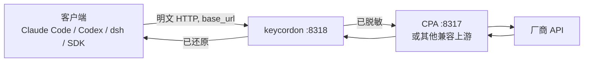
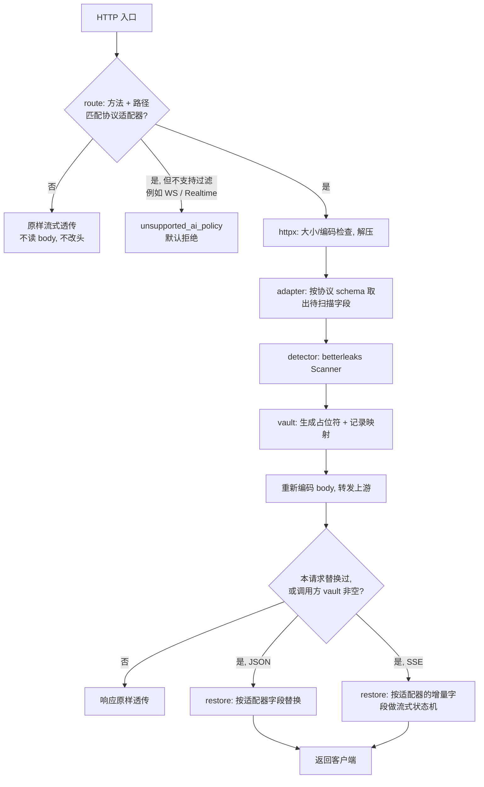

# keycordon 设计方案

一个面向 LLM API 的轻量反向代理：在请求离开本机前，把请求体中的密钥替换为占位符；在响应返回客户端前，把占位符还原为原值。检测引擎直接依赖 betterleaks v2 的 Go 库，不复制其代码。

文档版本：2026-11-19。依据的实测数据见文末「附录 A」。

> **实现说明（2026-11-20，v0.1 实现与本文的差异）**
>
> 本文是实现前的设计稿，正文保持原样。实际代码与之不同的地方以这里为准：
>
> 1. **占位符 TYPE 只由密钥值的前缀决定**（`ghp_` → `GITHUB_TOKEN`，`sk-ant-` → `ANTHROPIC_KEY`，其余 → `TOKEN`），不再取自规则 ID。同一个值在不同上下文被不同规则命中时，占位符仍然完全相同，前缀缓存更稳。
> 2. **流式还原改为「整事件挂起」**，代替 5.3 的逐字符 HOLD 状态机：某个增量末尾可能是占位符前半段时，整个事件先挂起，等同一流的下一个增量到达后，把这几个字符移到下一个事件里。流结束或遇到 `end_events` 时，挂起的事件原样发出。这样永远不需要构造新事件，事件条数与上游完全一致。
> 3. 未在 `deltas` 中声明的字符串（`response.output_text.done`、`response.completed` 等完整对象）只做**就地还原**，不跨事件挂起。
> 4. **Responses / Codex 的说明注入**改为在 `input` 数组开头插入一条 `developer` 消息（ChatGPT Codex 后端会校验 `instructions`）；`input` 不是数组时回退到 `instructions`。带 `previous_response_id` 的续写请求不注入，因为服务端保存的历史里已经有这条说明。说明以 `[keycordon/1]` 开头；请求中已含该标记时不重复注入。说明中的示例写作 `<SECRET_TYPE_xxxxxxxx>`，不符合占位符语法，不会被当成真实占位符。
> 5. 适配器新增 **`payload` 选择器**（工具入参、JSON Schema 等用户自定义对象）：其中的 `id`、`name`、`type` 等键不受公共冻结规则影响，照常扫描。
> 6. 扫描字符串叶子时，把所属键名作为上下文前缀（`"password": "…"`）一起交给 betterleaks，使依赖键名的规则在 JSON 叶子上也能生效；命中区间裁剪到值本身。JSON 字符串内嵌的 JSON（工具参数）会被解析并逐个扫描内层字符串，密钥按解码后的形式登记。
> 7. `bare-random-token` 与带上下文的规则重叠、且多出的部分以 `@`、`/`、`:` 等 URI 分隔符开头时，丢弃裸 token 命中，避免把连接串的 `@host/db` 一起替换。
> 8. 健康检查路径为 `/_keycordon/healthz`，避免遮住上游自己的 `/healthz`。
> 9. 日志统一走 slog（stderr），不单独写审计文件；第一版没有实现叶子级缓存（实测 64 KB 请求约 0.6 ms，暂不需要）和 `loose_match`。
> 10. 新增 Ollama 原生接口（`/api/chat`、`/api/generate`，NDJSON 流）与 Anthropic Message Batches（只扫描、不还原）的适配器。
> 11. **散文凭据规则是在真实模型联调后补的**：用小米 MiMo（`mimo-v2.6-flash`）实测时发现，「数据库密码是 hunter2-but-longer」「the password is pa55word-9x」这类消息里，默认规则和当时的自定义规则全部漏检，密钥原样发往上游。原因有两个：默认 `generic-password` 只认代码式赋值，散文里的标签后面既不是 `=` 也不是 `:` 而是「是 / is」；且 betterleaks 的 `keywords` 必须是文本中出现的 ASCII 小写字面量，所以中文标签需要一条无关键字规则。为此新增 `nl-credential-mention` 与 `nl-credential-mention-cjk`（见 4.4）。
> 12. 联调中确认：MiMo 兼容 OpenAI Chat Completions 与 Anthropic Messages 两种格式，`api-key` / `Authorization: Bearer` 两种头都接受；`/v1/models` 是 401/200 的普通透传路径；图像走 OpenAI `image_url` 的 `data:` URI；`/v1/embeddings`、`/v1/audio/*`、`/v1beta/*`（Gemini 格式）在该平台返回 404，属于上游不支持，与本代理无关。
> 13. **端点覆盖在 2026-11-24 又补了三处**：CPA 的 `POST /v1/tts`（xAI 自有字段 `text`/`voice_id`/`language`，不是 OpenAI 的 `input`）、`POST /v1/alpha/search` 与 `/backend-api/codex/alpha/search`（用户查询在 `commands.search_query[].q`）、以及此前漏匹配的 Realtime HTTP 控制端点（`/v1/realtime/translations`、`/realtime/calls/:id/{hangup,accept,reject,refer}`、`/v1/tunnel` 的 WebSocket）。适配器总数 24 → 26。
> 14. **维护流程见 [maintenance.md](maintenance.md)**：betterleaks 升级、新端点、同类实现变更这三件事的定期审查方法与判定标准；`./scripts/maintenance.sh` 一次跑完所有断言与基线核对。

## 1. 目标与非目标

**目标**

1. 客户端只改 `base_url` 即可接入，能放在 CPA 前面，也能放在任何 OpenAI / Anthropic / Gemini 兼容服务前面。
2. **影响面最小**：只处理已登记的 AI API 端点（见 4.0 与附录 B）；其他请求不读 body、不改头、不解压，按原样流式透传。已登记端点的请求中如果没有命中任何密钥，响应也原样透传。
3. **协议覆盖全面且易维护**：OpenAI Chat / Completions / Responses（含 Codex）、Anthropic Messages、Gemini（AI Studio、Vertex、Gemini CLI 内部端点）、Embeddings；生成类（images / videos / audio / moderations）、判定类（LiteLLM `/decisions` 与 `/systemone` 即 Jev / `/extraction` / `/ocr` / rerank / tokenize）。每种协议是一份声明式适配器加一组录制回放用例，新增协议不改核心代码。
4. 检测覆盖：betterleaks 默认规则（476 条）+ 无上下文的随机 token（裸 token）+ 复合变量名、无用户名 DB URI 等补充规则。
5. 双向处理：请求侧脱敏，响应侧（含 SSE 流式、工具调用参数）还原。思考/推理内容不还原（原因见 5.5）。
6. **前缀缓存零损失**：除「首次出现占位符」那一轮外，代理不得让任何已发过的字节发生变化。这条优先级高于其他所有优化（第 7 节）。
7. 占位符确定性：同一调用方、同一密钥永远得到同一占位符；密钥固定时可跨进程稳定。
8. 调用方隔离：A 调用方无法通过构造占位符拿到 B 调用方的密钥。
9. **无持久化**：映射只存内存，重启即丢弃。不需要数据库、不需要落盘任何密钥映射。唯一的本地状态是 master key 文件，它只用于派生占位符 ID，不含密钥内容。重启只影响旧占位符的还原，不影响安全。
10. 已登记端点的请求侧任何异常都拒绝请求（fail-closed）；响应侧异常只影响还原，不会泄密（fail-open）。
11. 性能：100 KB 请求体额外开销 < 2 ms；流式每个事件 < 50 µs。

**非目标（第一版）**

- 不做本地模型分类。
- 不做 TLS 拦截 / 正向代理（`HTTP_PROXY` 方式）。
- 不支持 WebSocket 内容过滤（Codex Responses WS、Realtime）。这类端点按 `unsupported_ai_policy` 处理，默认拒绝（见 4.0）。
- 不处理 AWS Bedrock 的 `application/vnd.amazon.eventstream` 二进制流、Ollama 原生 API（列入后续里程碑）。
- 不扫描图片、音频、PDF 等二进制内容；只扫请求中携带这些内容时的文本字段（prompt / text / instructions）。
- 不调用 betterleaks 的在线校验与身份分析（`analyze`、`credential` 包）。
- 不做任何持久化（无 SQLite / bbolt / 磁盘映射）。

## 2. 部署拓扑



- 代理默认只监听 `127.0.0.1`。需要局域网访问时必须能识别调用方（见 6.2）。
- 必须放在 CPA **前面**。CPA 之后的出站流量是 TLS，代理看不到内容。
- 上游按路径前缀路由，默认一条上游：

```yaml
upstreams:
  - prefix: /          # 默认，转发到 CPA
    url: http://127.0.0.1:8317
  - prefix: /deepseek  # 前缀会被去掉
    url: https://api.deepseek.com
```

## 3. 总体架构



### 3.1 目录结构

```text
cmd/keycordon/       # main：读配置、启动 HTTP server
internal/config/        # YAML 配置解析与校验
internal/route/         # 方法 + 路径 → 协议适配器；未命中即透传
internal/protocol/      # 协议适配器框架（字段选择器、SSE 事件表、凭据位置）
protocols/*.yaml        # 每种 AI API 一份声明式描述（见 4.0.2），随二进制 embed
internal/httpx/         # 已登记端点的限制、解压、头部过滤
internal/walk/          # 按选择器遍历字段、冻结字段、内层 JSON 递归
internal/detector/      # 唯一 import betterleaks 的包（薄 adapter）
internal/vault/         # 调用方隔离、确定性占位符、纯内存映射
internal/restore/       # 非流式与 SSE 流式还原
internal/proxy/         # 组装请求/响应管线，上游路由
internal/audit/         # 只记录规则 ID / 占位符 / JSON 路径，绝不记录原文
rules/proxy.toml        # 自定义规则（extend useDefault）
testdata/               # 回归语料：正例、反例
testdata/protocols/     # 每种协议录制的请求 / 非流式响应 / SSE 流（回放测试）
```

### 3.2 依赖

| 依赖 | 用途 | 说明 |
|---|---|---|
| `github.com/betterleaks/betterleaks/v2` | 检测引擎 | 钉死具体版本（当前 `v2.0.0-rc.9`），只用 `config`、`scan`、`rules`、`report` 四个包 |
| `github.com/klauspost/compress` | gzip / zstd 解压 | betterleaks 和 CPA 同类选型 |
| `github.com/andybalholm/brotli` | br 解压 | 可选 |
| `gopkg.in/yaml.v3` | 配置 | — |
| 标准库 `net/http`、`net/http/httputil`、`encoding/json` | 代理与 JSON | 不引入 Web 框架 |

## 4. 请求侧管线

### 4.0 路由与协议适配器（`route` / `protocol`）

#### 4.0.1 只处理已登记的端点

每个请求先用「方法 + 路径」匹配协议适配器，**在读取 body 之前**完成：

| 匹配结果 | 处理 |
|---|---|
| 未匹配任何适配器 | 用 `httputil.ReverseProxy` 原样流式透传：不读 body、不解压、不改任何头、不扫描、不还原。`/v1/models`、`/healthz`、管理接口、OAuth 回调、文件上传、图片/视频生成等都走这里 |
| 匹配，适配器标记为 `filter: true` | 进入 4.1 起的过滤管线 |
| 匹配，适配器标记为 `filter: unsupported`（WebSocket、Realtime、未来新增但尚未实现的协议） | 按 `unsupported_ai_policy`：`reject`（默认，返回 501 说明原因）或 `passthrough`（不过滤，审计中记一条警告） |

路径匹配只看「路径尾部」，允许任意前缀。这样同一份适配器能同时匹配 `/v1/chat/completions`、`/openai/v1/chat/completions`、`/api/paas/v4/chat/completions`（智谱）、`/deepseek/v1/chat/completions` 以及上游路由前缀。完整端点表见附录 B。

为什么不改成「所有 JSON 都扫」：上一版方案为了不漏 Gemini 选择了全扫，代价是影响面大（管理接口、OAuth、第三方 JSON 接口都会被改写）。现在用适配器显式登记端点，既保证 Gemini 等协议被覆盖，又把改写范围限定在 AI 请求内。代价是**新出现的 AI 端点在登记前会被透传**，因此需要 4.0.4 的兜底检测。

#### 4.0.2 适配器是声明式的

每种协议一份 YAML，随二进制 `embed`，也可以从配置目录加载覆盖。核心代码只认识这份描述，不包含任何协议专用逻辑。示例（Anthropic Messages）：

```yaml
id: anthropic-messages
match:
  - method: POST
    path_suffix: /v1/messages
  - method: POST
    path_suffix: /v1/messages/count_tokens
filter: true
request:
  scan: all_strings            # 在 body 内扫描所有字符串叶子，再排除 frozen
  frozen:                      # JSONPath 风格选择器
    - $..id
    - $..tool_use_id
    - $.model
    - $..type
    - $..signature
    - $..[?(@.type=="thinking")].thinking
    - $..[?(@.type=="redacted_thinking")].data
    - $..source[?(@.type=="base64")].data
  inner_json: []               # Anthropic 的 tool_use.input 已经是对象，无需二次解析
  instruction:
    target: $.system            # 字符串或 content block 数组都要支持
    mode: append
response:
  json:
    restore: all_strings
    skip:
      - $..[?(@.type=="thinking")].thinking
      - $..signature
  sse:
    stream_key: $.index         # content_block_delta 的 index
    deltas:
      - event: content_block_delta
        when: $.delta.type == "text_delta"
        field: $.delta.text
        kind: text
      - event: content_block_delta
        when: $.delta.type == "input_json_delta"
        field: $.delta.partial_json
        kind: json_fragment     # 还原值需按 JSON 字符串转义（见 5.3）
      - event: content_block_delta
        when: $.delta.type == "thinking_delta"
        field: $.delta.thinking
        kind: reasoning         # 不还原（见 5.5）
    end_events: [content_block_stop, message_stop]
    unknown_events: restore_all_strings
```

请求侧默认 `scan: all_strings` 加冻结列表，而不是「只列出要扫的字段」。原因：AI API 的请求体几乎所有文本字段都可能带用户内容（消息、工具结果、工具描述、system、metadata），白名单写漏一个就是泄漏；冻结列表写漏一个最多是改错一个字段，并且会在回放测试里暴露。

**维护成本控制**：

- 公共冻结项（各类 `id`、`model`、`signature`、`data:` URI）放在 `protocols/_common.yaml`，各协议通过 `extends: _common` 继承。
- 协议差异只体现在 SSE 增量表和少数专有字段，一份适配器通常 30–60 行。
- 每个适配器必须配套 `testdata/protocols/<id>/`：至少一个请求样本、一个非流式响应、一个带工具调用的 SSE 流。CI 中缺少用例的适配器加载失败。
- 新增协议的流程：写 YAML → 录制样本 → 跑回放测试，不改 Go 代码。只有出现新的「增量类型」（例如二进制流）时才需要改核心。

#### 4.0.3 凭据位置与调用方识别

适配器同时声明该协议的凭据位置，用于识别调用方（6.2），以及确保凭据本身不被扫描和改写：

| 协议 | 凭据位置 |
|---|---|
| OpenAI 系 | `Authorization: Bearer …` |
| Anthropic | `x-api-key`，或 `Authorization: Bearer …`（OAuth / 代理） |
| Gemini AI Studio | `x-goog-api-key`，或查询参数 `?key=` |
| Vertex AI | `Authorization: Bearer …`（OAuth access token） |
| CPA 额外接受 | 查询参数 `?auth_token=` |

`?key=` 需要支持：Google 官方 REST 文档的示例和 `curl` 写法都用 `?key=`，`google-generativeai` 等旧 SDK、大量第三方客户端、以及 Gemini Live（WebSocket，见附录 B）也用查询参数。CPA 的接入认证同样同时接受 `?key=` 和 `?auth_token=`（`internal/access/config_access/provider.go`）。Gemini CLI 默认用 `x-goog-api-key` 头。

处理要求：

- 查询参数中的凭据**原样转发**，不做替换（上游需要用它认证）。
- 日志、审计、错误信息中的 URL 一律先脱敏 `key`、`auth_token`、`access_token` 等参数。
- 查询参数中除凭据外的其他值不扫描（AI 请求的内容都在 body 里）。

#### 4.0.4 未登记 AI 流量的兜底

透传的请求不做过滤，但可以做一次低成本的「漏网检测」，用来发现适配器表需要补充的端点：

- 对透传的 `POST` 请求，只看 `Content-Type: application/json` 且 body 前 4 KB 中出现 `"messages"`、`"contents"`、`"input"`、`"prompt"`、`"instructions"` 之一。
- 命中时不改写、不阻断，只在审计中记录 `unregistered_ai_endpoint` 及路径。
- 需要读取 body 前缀，因此用 `io.TeeReader` 边读边转发，不缓冲整个 body。可配置关闭以做到完全零接触。


### 4.1 入口检查（`httpx`）

以下检查只作用于已登记且 `filter: true` 的端点。按顺序执行，任何一步失败直接返回错误，**不转发**：

| 检查 | 规则 | 失败响应 |
|---|---|---|
| WebSocket 升级（落在 `filter: true` 端点上，例如 Codex 对 `/v1/responses` 的 WS 升级） | `Upgrade: websocket` | 按 `unsupported_ai_policy`，默认 426，客户端会回退 HTTP |
| body 大小 | 压缩前 ≤ `max_body_bytes`（默认 8 MiB），解压后 ≤ `max_decoded_bytes`（默认 16 MiB） | 413 |
| `Content-Encoding` | 支持 `identity`、`gzip`、`deflate`、`zstd`、`br`，可多层；其他编码 | 415 |
| 解压 | 使用带上限的 reader，防止解压炸弹 | 400 |
| `Content-Type` | 必须是 `application/json`（含 `+json`、缺省视为 JSON）；`multipart/form-data` 仅限适配器声明 `content_type: multipart` 的端点（见 4.8）；已登记 AI 端点出现其他类型视为异常 | 415 |
| JSON 解析 | 解析失败 | 400 |

解压后转发给上游的 body 一律为**未压缩**，同时删除 `Content-Encoding` 并重算 `Content-Length`。CPA 能接收未压缩 body，不影响兼容性。

### 4.2 字段遍历（`walk`）

`walk` 由适配器驱动：先在请求体内取所有字符串叶子，再剔除适配器 `frozen` 选择器命中的路径，剩下的交给 detector。

遍历规则：

1. 使用 `json.Decoder` + `UseNumber()` 解析，保证大整数不丢精度。
2. 维护当前 JSON 路径（例如 `messages[3].content[0].text`），供冻结判断和审计使用。
3. 字符串值如果以 `{` 或 `[` 开头且能解析为 JSON（典型例子是 `tool_calls[].function.arguments`），递归进入内层，扫描完再序列化回字符串。
4. 递归深度上限 `max_json_depth`（默认 128），超限返回 400。privacy-gateway 在 2000 层嵌套时直接 `RecursionError`。
5. 对象的 key 不扫描、不改写。

**公共冻结字段**（`_common.yaml`，各适配器继承；这些 key 下的值原样保留，不扫描）：

| 类别 | key |
|---|---|
| 协议标识 | `id`, `call_id`, `tool_call_id`, `tool_use_id`, `previous_response_id`, `response_id`, `conversation_id`, `model`, `role`, `type`, `object`, `name`, `status`, `index` |
| 签名（改了上游返回 400） | `signature`, `thoughtSignature`, `thought_signature`, `encrypted_content`, `redacted_thinking.data` |
| 二进制载荷 | `image_url.url` 中的 `data:` URI、`source.data`（Anthropic base64 图片/文档）、`inlineData.data`、`input_audio.data`、`file_data` |

`data:*;base64,` 前缀的字符串无论在哪个 key 下都跳过。

**不扫描的思考内容**：请求历史中的思考块（Anthropic `thinking`、OpenAI Responses `reasoning` 的 `summary`、Gemini `thought: true` 的 part、DeepSeek / OpenAI 兼容格式的 `reasoning_content`）。Anthropic 和 Gemini 的思考文本与签名绑定，改动会导致上游 400；其他格式虽然可改，但这些内容通常由模型生成且已在上一轮响应侧处理过（见 5.5），统一冻结以保证行为一致。这意味着：**如果模型在思考中复述了密钥，下一轮它会以明文形式随历史上传**。对策见 5.5。

**重新编码：必须做字节区间局部替换**（不是可选优化）。整体重新序列化会重排 map key、丢空白、改数字格式，导致第 2 轮起整个前缀缓存失效，因此：

- 解析时记录每个字符串叶子在原始 body 中的字节区间；
- 只在原始字节上替换被修改的区间，其余字节原样拷贝；
- 没有任何替换时不重建 body，直接转发原始字节。

细节与理由见 7.5。这一步属于 M1 必做项。

### 4.3 检测（`detector`）

`detector` 是唯一 import betterleaks 的包，对外只暴露：

```go
type Hit struct {
    RuleID     string
    Value      string // 原始密钥值（Match.Value）
    Start, End int    // 在被扫描字符串内的字节偏移
    Confidence string
}

type Detector interface {
    Scan(s string) []Hit
}
```

实现要点：

1. **初始化**：`config.ParseTOML(proxy.toml)`，其中 `[extend] useDefault = true`；`scan.New(cfg, scan.WithPrecompile(), scan.WithMaxDecodeDepth(n), scan.WithLogger(...))`。Scanner 全局单例，实测并发安全。
2. **偏移换算**：betterleaks 的 `Finding.Location` 是 1 起始的行号 + 字节列，且覆盖的是整条匹配 `Match.Full`，不是密钥值本身。换算步骤：
   - 预先计算被扫描字符串的行首偏移表；
   - `(StartLine, StartColumn)`、`(EndLine, EndColumn)` 换成字节区间 `[a, b)`；
   - 在 `s[a:b]` 内查找 `Match.Value`，得到精确区间；查不到时退化为在整个 `s` 中查找所有出现位置。
3. **解码命中**（`Finding.Encodings` 非空，例如 base64 内藏的密钥）：位置对应解码后的文本，无法精确映射。处理方式：在原始字符串里找出覆盖该位置的连续编码片段（base64 / hex / percent 字符集的最长连续串），把**整个编码片段**当作密钥替换。
4. **重叠与去重**：多个命中区间重叠时，取并集作为一个替换区间；同一值多次出现全部替换。
5. **最短长度**：`Value` 长度 < 8 的命中丢弃（避免把常见短词换成占位符）。
6. **按字符串而非按整个 body 扫描**：每个叶子调用一次 `ScanString`。实测 400 个 finding 时，逐叶子扫描（53 ms）比整体扫描（78 ms）更快，且位置天然准确。

### 4.3.1 否决（`veto`）

规则靠上下文命中（`PASSWORD=`、`password is`），而上下文也出现在**值不是密钥**的地方：变量名、文件路径、包版本、过期时间。把这些替换掉会破坏 agent（它再也读不到被指向的路径），还白白重建一次前缀缓存。

`internal/veto` 在检测之后、生成占位符之前做一次否决，命中即「原样发出」：

| 检查 | 例子 | 理由 |
|---|---|---|
| `pathValue` | `~/.ssh/id_ed25519`、`/home/alice/.ssh/id_rsa`、`C:\Users\alice` | 路径是位置，不是值；agent 需要它去读文件 |
| `versionValue` | `9.2.0-beta1`、`^4.0.0-beta.1`、`v1.2.3` | 版本号是公开的 |
| `timestampValue` | `2026-08-30T11:44:31.312645+08:00` | 过期时间不是密钥 |
| `lineRef` | `L643-669`、`643:12` | 行号引用；纯数字不算（可能是弱口令） |
| `namesASecret` | `get_access_token_v2`、`env.SECRET_V2`、`refreshToken` | 由 2 个以上单词组成、含 secret 词根的**标识符**是函数名或变量名 |
| `codeChain` | `os.environ`、`config.settings.database` | 小写标识符的点链是代码 |
| `nextField` | `UI_PASSWORD= UI_ADDR=127.0.0.1:39117` | 规则允许 `=` 后有空格，于是把下一个字段当成了值 |

**每个检查都是「这肯定不是密钥」**，所以误判的后果只是「该值原样发出」——与没有这个检查时相同，失败方向安全。代价是：**字面量恰好是点分小写标识符的口令不会被替换**（例如 `数据库密码是 correcthorsebattery` 会被替换，但 `数据库密码是 config.settings` 不会）。

评估集（4.4.1）里每个 `keep` 用例都对应上表的一行。

### 4.4 规则集（`rules/proxy.toml`）

```toml
title = "keycordon"
minVersion = "v2.0.0-rc.9"

[extend]
useDefault = true
# 对话流量里误报偏多、且已被下面自定义规则覆盖的默认规则，按需加入
disabledRules = []
```

需要补充的自定义规则（均已在附录 A 中确认 betterleaks 默认规则漏检）：

| 规则 ID | 目标 | 要点 |
|---|---|---|
| `bare-random-token` | 无 `KEY=` 上下文的随机 token | 见下方完整定义 |
| `compound-env-secret` | `POSTGRES_PASSWORD=`、`AWS_SECRET_ACCESS_KEY=`、`SMTP_PASSWORD=` 等复合变量名 | key 允许任意前后缀：`[A-Z0-9_]*(?:PASSWORD\|PASSWD\|PWD\|SECRET\|TOKEN\|API_?KEY\|CREDENTIAL\|PRIVATE_KEY)[A-Z0-9_]*` |
| `db-uri-anon-user` | `redis://:pass@host` | 用户名为空的连接串 |
| `openai-project-key` | `sk-proj-…` / `sk-svcacct-…` 新格式 | 默认规则只认含 `T3BlbkFJ` 的旧格式，新格式靠 generic 规则，需要 `KEY=` 上下文 |
| `yaml-netrc-secret` | `password: xxx`（无 `=`）、`.netrc` 的 `password xxx` | 行首锚定 |
| `nl-credential-mention` | 英文散文里的凭据：「the password is X」「token: Y」 | 默认规则只认代码式赋值，聊天里提到的密码会整段漏掉（实测 MiMo 测试中发现） |
| `nl-credential-mention-cjk` | 中文散文里的凭据：「数据库密码是 X」「口令：Y」「秘钥 Z」 | 必须单独一条：betterleaks 的 `keywords` 只能是文本中出现的 ASCII 小写字面量，中文标签无法作为关键字，只能写无关键字规则 |

`token-with-plus` 无需单列，`bare-random-token` 的字符集已包含 `+`。

散文规则（两条共用同一个 filter 思路）：

```toml
[[rules]]
id = "nl-credential-mention"
regex = '''(?i)(?:password|passwd|passphrase|secret|token|api[ _-]?key|credential)[ \t]{0,3}(?:=>|:=|[:=]|is|are|was|were)[ \t]{0,3}["`]?([^\s"`,;，。]{8,256})["`]?'''
valueGroup = 1
keywords = ["password", "passwd", "passphrase", "secret", "token", "credential"]
---
[[rules]]
id = "nl-credential-mention-cjk"
regex = '''(?:数据库|登录|访问|用户)?(?:密码|口令|密钥|秘钥|令牌|凭证|票据)(?:(?:=>|:=|[:=：＝]|是|为|＝)[ \t]{0,2}|[ \t]+)["`]?([^\s"`,;，。、]{8,256})["`]?'''
valueGroup = 1
# 无 keywords
```

filter 的关键一条：**散文里绝大多数候选是普通单词**（"the password is required"），所以只保留「含符号」或「混合大小写 + 数字 + 长度 ≥ 10」的候选：

```toml
matchesAny(finding["secret"], [
  `^\$\{?[A-Za-z_][A-Za-z0-9_]*\}?$`,   // ${DB_PASS}
  `^<[^>]+>$`,                          // <placeholder>
  `^(?i:required|optional|changeme|string|number|boolean|null|...)$`,
  `^\d+$`, `^[a-z]+$`, `^[A-Z]+$`,      // 纯单词/纯数字
  `^(?i:os\.environ|os\.getenv|process\.env|env\.|config\.)`,
  `[\[\({]$`,                           // 代码片段
  `^[^@\s]+@[A-Za-z0-9-]+(?:\.[A-Za-z0-9-]+)+$`   // 邮箱
])
|| (!matchesAny(finding["secret"], [`[^A-Za-z0-9]`])
    && !(matchesAny(finding["secret"], [`[a-z]`])
         && matchesAny(finding["secret"], [`[A-Z]`])
         && matchesAny(finding["secret"], [`[0-9]`])
         && len(finding["secret"]) >= 10))
```

代价：**纯字母密码在散文里不会被这两条规则命中**（例如「密码是 correcthorse」）。前缀规则（`ghp_`、`sk-ant-`）和赋值规则（`PASSWORD=…`）仍然覆盖这类值，所以只影响「纯字母 + 只出现在散文里」这一种组合。这是有意的取舍：不加这条限制，几乎每个含 password/token 字样的英文句子都会误报。


`bare-random-token` 定义（已在 betterleaks 库中验证可运行）：

```toml
[[rules]]
id = "bare-random-token"
description = "High-entropy token without assignment context"
confidence = "medium"
specificity = -200            # 比默认规则低，其他规则先认领
regex = '''(?:^|[\s"'`(\[{<,;:=])([A-Za-z0-9_\-+/=.]{16,128})(?:$|[\s"'`)\]}>,;])'''
valueGroup = 1
keywords = ["0","1","2","3","4","5","6","7","8","9"]
filter = '''
len(finding["secret"]) < 16
|| entropy(finding["secret"]) <= 3.3
|| tokenRatio(finding["secret"]) > 2.05
|| matchesAny(finding["secret"], [
  `^[0-9a-fA-F]{8,128}$`,
  `^[0-9a-fA-F]{8}-[0-9a-fA-F]{4}-[0-9a-fA-F]{4}-[0-9a-fA-F]{4}-[0-9a-fA-F]{12}$`,
  `^(?i:sha1|sha256|sha512|md5|blake2b|blake3)[:=]`,
  `^\d{4}-\d{2}-\d{2}[T ]\d{2}:\d{2}`,
  `^v?\d+(?:\.\d+){1,3}`,
  `^(?i:claude|gpt|grok|gemini|deepseek|qwen|llama|mistral|gemma|kimi|glm|o[1-4])[-.]`,
  `^[A-Z][A-Z0-9]*(?:_[A-Z0-9]+)+$`,
  `^[a-z][a-z0-9]*(?:_[a-z0-9]+)+$`,
  `^[a-z]+(?:[A-Z][a-z0-9]+)+$`,
  `^(?:iVBORw0KGgo|/9j/|R0lGOD|JVBERi0|UEsDBBQ|H4sI)`
])
'''
```

判定依据是 BPE token 比率（字符数 / cl100k token 数）：随机串约 1.0–2.0，人写的标识符和文字约 2.5–8。比 Shannon 熵更能区分 git SHA、`VAULT_KEY_SOURCE` 这类「高熵但不是密钥」的串。附录 A 的离线评测中，这套「结构白名单 + token 比率 + 熵」组合达到 precision 0.970 / recall 0.963。

**规则质量保证**：

- 每条自定义规则写 `[[rules.tests]]`（betterleaks 原生支持规则内测试），至少 3 个应命中、3 个不应命中。
- 启动时编译全部规则与 filter 表达式，任何错误直接退出。
- 已知风险：filter 表达式运行时出错会被当作「不过滤」（finding 保留）。CI 必须跑 `testdata/` 回归集，防止表达式写错导致大面积误报或漏报。

#### 4.4.1 评估集（`internal/detector/testdata/eval.json`）

规则内测试只覆盖单条规则；评估集覆盖**整条决策链**（规则 + 否决），是 CI 的回归门槛。

每条用例是一个 agent 会发出的文本，带两组值：

```json
{
  "id": "path-value",
  "text": "PRIVATE_KEY_PATH=~/.ssh/id_ed25519",
  "want": [],
  "keep": ["~/.ssh/id_ed25519"]
}
```

- `want`：必须被替换的值（漏检 → recall 下降）。
- `keep`：必须原样保留的值（误报 → precision 下降）。
- 两组都为空的值不参与评分。

`TestEvalCorpus` 计算 precision / recall，门槛都是 **0.95**。当前 33 条用例：precision 1.000、recall 1.000。

用例来源是「用户报告的错误遮蔽」——每一条 `keep` 都对应一次真实的误报（见 4.3.1 的表）。新增规则或调整 filter 时，先加用例再改规则。

### 4.5 替换与占位符

单个字符串叶子内，按命中区间从后往前替换，避免偏移错位：

```text
原文:  export OPENAI_API_KEY=sk-proj-AbCd...UvWx && run
替换:  export OPENAI_API_KEY=<SECRET_API_KEY_3f9a2c71> && run
```

占位符格式与生成方式见第 6 节。

### 4.6 占位符说明注入

当请求中出现占位符（本次替换产生的，或历史中已有的）时，在适配器 `instruction.target` 指定的位置追加一段固定说明（可关闭）：

| 协议 | 注入位置 |
|---|---|
| OpenAI Chat / Completions 兼容 | `messages` 最前插入一条 `system`（已有 system 时追加到其末尾） |
| OpenAI Responses | 追加到 `instructions` |
| Anthropic Messages | 追加到 `system`（字符串或 content block 数组） |
| Gemini | 追加到 `systemInstruction.parts` |

说明文本（固定，不含任何变量）：

```text
Some values in this conversation are replaced by placeholders of the form
<SECRET_TYPE_xxxxxxxx>. Treat each placeholder as the real value and copy it
exactly when you need to use it. Never alter, split, decode or guess it, and
do not repeat it in your reasoning unless it is required for the task.
```

最后一句来自「要求模型不在思考中复述密钥」的想法，评估见 5.5。

缓存影响：说明只在「首次出现占位符」的那一轮改变 system 前缀，之后每轮都相同，缓存继续命中。说明必须追加在 system 末尾而不是开头，尽量保留客户端原有的缓存断点（Anthropic `cache_control`）。滚动窗口截断、说明被丢弃等边缘情况的完整分析见第 7 节。

### 4.7 只有 prompt / text 字段的端点（生成类与判定类）

图片、视频、语音、判定、抽取、重排这些端点不像聊天接口那样有完整的 `messages` 历史，它们的用户内容集中在一两个字段里，语义也不同：**即使是一段 prompt，也不会进入下一轮上下文**。因此它们不需要「前缀缓存」考虑，只需要「把这一轮的字段扫干净」。

这类端点统一交给一个**只扫指定字段**的适配器族处理，配置上是一个 `fields` 列表而不是 `scan: all_strings`：

```yaml
id: openai-images
match:
  - method: POST
    path_suffix: /images/generations
  - method: POST
    path_suffix: /images/edits
filter: true
content_type: json_or_multipart   # edits 可能是 multipart
request:
  scan: fields                    # 只扫下列字段，其余原样
  fields:
    - $.prompt                    # 字符串或字符串数组
    - $.negative_prompt
    - $.background
  frozen:
    - $..image                    # base64 图片本体
    - $..mask
    - $..response_format
  instruction: false              # 这类端点没有 system 概念，不注入
response:
  json:
    restore: all_strings          # 响应里的 revised_prompt 可能回显原文，按需还原
  sse: none
```

各端点需要扫的字段（依据各自 API 文档；`$.` 表示请求体根）：

| 适配器 ID | 端点 | 待扫字段 | 备注 |
|---|---|---|---|
| `openai-images` | `POST /images/generations` | `prompt`、`negative_prompt` | 响应里 `data[].revised_prompt` 要还原 |
| `openai-images` | `POST /images/edits`、`/images/variations` | `prompt` | **multipart**：`prompt` 在文本 part，`image`/`mask` 是文件 part，原样透传 |
| `openai-videos` | `POST /videos`、`/videos/generations`、`/videos/edits`、`/videos/extensions`、`/videos/{id}/remix` | `prompt` | Sora / Veo；异步任务，只扫创建请求 |
| `openai-audio` | `POST /audio/speech` | `input` | TTS。响应是二进制音频，无还原 |
| `openai-audio` | `POST /audio/transcriptions`、`/audio/translations` | `prompt` | **multipart**；音频文件 part 透传。`prompt` 是可选的上下文提示 |
| `openai-moderations` | `POST /moderations` | `input` | 字符串或数组；响应只含分数，无还原 |
| `openai-rerank` | `POST /rerank`、`/v1/rerank` | `query`、`documents[]` | 文档数组可能很长，必须扫；响应只含索引与分数 |
| `openai-embeddings` | `POST /embeddings` | `input` | 已列在附录 B（P1），归类到这里 |
| `litellm-decisions` | `POST /decisions` | `input[]`（含 `content[].text`）、`questions[].instructions`、`questions[].choices[].description`、`questions[].levels[].description` | OpenAI Decisions 格式 |
| `litellm-systemone` | `POST /systemone` | `state`（字符串/对象/数组）、`questions[].instructions`、`questions[].criteria`（对象或数组，含说明文字） | TypeSafe Jev 格式；`state` 可能整个就是要判定的文本 |
| `litellm-extraction` | `POST /extraction` | `state`、`fields[].instructions` | 抽取模型；`images[]` 冻结 |
| `litellm-ocr` | `POST /ocr` | `text`、`instructions`（若有） | 图片本体冻结 |
| `litellm-tokenize` | `POST /tokenize` | `text`、`messages` | 只有请求，无还原 |

`response.restore` 的默认值：

- 生成类（images / videos / audio / moderations / rerank / embeddings / tokenize）：响应里不会出现占位符，`restore: none`。唯一例外是 images 的 `revised_prompt` 与 videos 的任务 `prompt` 回显，用 `restore: all_strings` 更省心。
- 判定类（decisions / systemone / extraction / ocr）：响应是结构化答案（概率、标签、抽取字段），**理论上不含占位符**。但抽取模型的答案可能是「原文的某个 span」，若输入被替换过，span 会指向占位符 → 设 `restore: all_strings`，保证客户端拿到的是原文 span。

**判定类端点的特殊风险**：

1. **判定结果会因替换而改变**。例如「这段文本是否包含 API key」的判定问题，替换后答案必然从 true 变成 false。这是**预期行为**（我们就是不希望模型看到密钥），但使用方需要知道：这类决策模型看到的不是原始数据。文档中明确说明，必要时可对这些端点设 `mode: observe` 或加入 `skip_paths`。
2. **抽取/OCR 的 span 偏移**。若输入被替换，模型返回的 span 是**替换后文本**的偏移。还原时如果只替换 span 内容会错位；正确做法是：先还原整个 `state`，再让客户端按原文自行定位；或直接不还原 span，只还原文本答案里的占位符。第一版选后者（`restore: all_strings`），并在文档中说明 span 偏移不可靠。
3. **questions / fields 的 instructions 通常是开发者写的**，不含用户数据，但成本极低、且以防万一，一并扫描。

**为什么不用 `scan: all_strings`**：这些端点的请求体里常有 base64 图片、音频、大段 embedding 输入数组，全扫既浪费又容易误报。用 `fields` 白名单在适配器里显式声明，比在 `frozen` 里排除更容易审查。

### 4.8 multipart 端点的文本 part 处理

`/images/edits`、`/audio/transcriptions`、`/audio/translations` 用 `multipart/form-data`。适配器声明 `content_type: json_or_multipart` 和 `multipart_text_fields: [prompt]` 时：

1. 用流式 multipart reader 解析，**不缓冲文件 part**。
2. 文本 part 的值按普通字符串扫描与替换。
3. 文件 part 原样转发（`image`、`mask`、`file`、`audio`）。
4. 转发时重建 multipart body：文本 part 用替换后的值，文件 part 用原始字节；重新生成 boundary 和 `Content-Length`。
5. 只含单个小文件（< 1 MiB）时允许整体缓冲以便简化实现；超过阈值则流式转发并跳过文件 part 的替换（文件本来也不扫）。

**已知限制**：multipart 重建会改变 body 字节，但这些端点没有前缀缓存，所以无成本影响。

## 5. 响应侧还原（`restore`）

还原只做「占位符 → 原值」的查表替换，**不在响应侧调用 betterleaks**。原因：响应是分片的，实测一个 token 被切成两个 SSE 事件后 betterleaks 检测不到；而且响应里的密钥只可能来自请求时被替换的那些值（或者模型自己编的，那不是我们要保护的对象）。

### 5.1 占位符识别

占位符语法固定：`<SECRET_{TYPE}_{ID8}>`，其中 `TYPE` 为 `[A-Z0-9_]{1,32}`，`ID8` 为 8 位小写 hex。识别时只认这个语法，并且必须在**当前调用方**的 vault 中查得到，否则原样输出。

模型常见的「篡改」情况及处理：

| 模型输出 | 处理 |
|---|---|
| `<SECRET_API_KEY_3f9a2c71>` | 正常还原 |
| `SECRET_API_KEY_3f9a2c71`（丢了尖括号） | 可选宽松匹配 `loose_match: true`：按 `SECRET_[A-Z0-9_]+_[0-9a-f]{8}` 识别，同样必须在 vault 中命中才还原 |
| `\u003cSECRET_...\u003e`（JSON 转义尖括号） | 在 JSON 解码后的字符串上做还原，天然处理 |
| `&lt;SECRET_...&gt;`（HTML 转义） | 不处理，原样输出 |
| 占位符被改了字符 | vault 查不到，原样输出 |

### 5.2 非流式 JSON 响应

0. 触发条件：本次请求做过替换，或该调用方 vault 非空；否则响应原样透传。还要求 body 中包含字节串 `SECRET_`，不包含时也原样透传（`bytes.Contains`，成本可忽略）。
1. 解压（若上游返回压缩），解析 JSON。
2. 遍历所有字符串叶子，跳过适配器 `response.json.skip` 中的字段（签名、思考内容），做占位符替换。
3. 字符串叶子本身是 JSON（工具调用参数）时，先解析，再还原内层字符串，再序列化回去。这样原值中的 `"`、`\`、换行会被正确转义。
4. 同样按字节区间局部替换（7.5）；只有真的发生还原时才重建 body，否则转发原始字节。
5. 响应不是 JSON 时，按字节扫描占位符替换。

### 5.3 SSE 流式响应

这是整个项目最复杂的部分。增量字段由适配器的 `response.sse.deltas` 声明，核心代码只实现三种 `kind`：

| kind | 含义 | 还原方式 |
|---|---|---|
| `text` | 普通文本增量 | 流式状态机，原值原样输出 |
| `json_fragment` | JSON 文本片段（工具参数增量） | 流式状态机，原值按 JSON 字符串转义输出 |
| `reasoning` | 思考 / 推理增量 | 不还原，原样透传（5.5） |
| `object` | 一次性给出的完整对象 | 按 5.2 递归还原 |

各协议的声明（完整表见附录 B）：

| 协议 | `text` | `json_fragment` | `reasoning` | 流 ID |
|---|---|---|---|---|
| OpenAI Chat 兼容 | `choices[i].delta.content` | `choices[i].delta.tool_calls[j].function.arguments` | `choices[i].delta.reasoning_content` / `reasoning` | choice index + tool_call index |
| OpenAI Responses | `response.output_text.delta` 的 `delta` | `response.function_call_arguments.delta`、`response.custom_tool_call_input.delta` 的 `delta` | `response.reasoning_summary_text.delta`、`response.reasoning_text.delta` | `item_id` + `content_index` |
| Anthropic Messages | `text_delta.text` | `input_json_delta.partial_json` | `thinking_delta.thinking`、`signature_delta` | content block `index` |
| Gemini（含 Vertex、Gemini CLI 内部端点） | `candidates[i].content.parts[k].text`（`thought` 不为 true） | 无（`functionCall.args` 一次性给出完整对象，按 `object` 处理） | `thought: true` 的 part | candidate index + part index |

未在适配器中声明的事件，按 `unknown_events` 处理：默认对其所有字符串叶子做 `text` 类还原，流 ID 用 JSON 路径。

**状态机**（每个流 ID 一个实例）：

```text
状态 PASS：正常输出字符；遇到 '<'（或宽松模式下遇到 'S'）进入 HOLD
状态 HOLD：缓冲字符
  - 缓冲内容仍是 "<SECRET_...>" 合法前缀 → 继续 HOLD
  - 遇到 '>' 且语法完整 → 查 vault，命中输出原值，不命中输出原文 → PASS
  - 不再是合法前缀 → 输出缓冲区的第一个字符，剩余部分重新喂入 → PASS 或 HOLD
  - 缓冲长度 > 64 → 全部输出 → PASS
流结束（[DONE]、message_stop、response.completed、finish_reason 非空、连接关闭）
  → 输出全部剩余缓冲
```

**输出时机**：状态机吐出的字符写回**当前事件**的同一字段；如果当前事件的增量全部被缓冲，就输出一个空增量事件（保持事件序列与上游一致），等下一个事件再补上。流结束时的剩余字符，附加到结束事件之前的最后一个同类事件；如果已经没有同类事件，构造一个只含该字段的增量事件插在结束事件之前。

**工具参数还原的转义**：工具参数增量（`arguments`、`partial_json`）是**JSON 文本片段**，不是普通字符串。占位符出现在其中时，处在某个 JSON 字符串字面量内部，还原值必须按 JSON 字符串规则转义后再输出（`"` → `\"`，`\` → `\\`，控制字符 → `\uXXXX`）。普通文本增量（`content`、`text`）不需要这一步。

**完整对象型增量**（Gemini `functionCall.args`、Responses `response.output_item.done` 中的完整参数）：直接按 5.2 的方式递归还原。

**透传约束**：

- 非 `data:` 行（`event:`、`id:`、`retry:`、注释行）原样输出。
- 不认识的事件类型也做「全部字符串叶子」的状态机还原，流 ID 用 JSON 路径。
- 每个事件处理完立即 `Flush()`，不额外合并或延迟。
- `data:` 内容不是 JSON 时，按字节状态机处理。

### 5.4 还原失败与安全边界

- 还原失败只会导致客户端看到占位符，**不会**导致密钥外泄，因此响应侧采用 fail-open（出错时原样输出该事件）。
- 还原只使用当前调用方的 vault 分区（见 6.2）。

### 5.5 思考内容与「要求模型不在思考中复述密钥」

**结论：作为提速手段基本无效；作为体验和稳健性改进有小幅价值，已作为说明文本的一句话纳入（4.6），不单独设计功能。**

逐条分析：

1. **请求侧扫描量不会减少。** 请求侧不能依赖模型是否听话，凡是会上传的内容都要扫。而思考内容在请求侧本来就是冻结字段（Anthropic / Gemini 的思考与签名绑定，改了会 400），已经不在扫描范围内，这条指令省不掉任何 betterleaks 调用。请求侧的主要成本是每轮重复上传的历史消息，对应的优化是第 11 节的「叶子级缓存」，效果远大于这条指令。
2. **响应侧本来就很便宜。** 响应侧不调用 betterleaks，只做 `SECRET_` 字节查找加状态机，每个事件在微秒级。思考增量的 kind 是 `reasoning`，直接透传，根本不进状态机。
3. **模型思考里看到的只是占位符，不是密钥。** 模型从未见过原值，除非检测器漏检。漏检时密钥已经在本轮上传了，模型复述与否不改变泄露事实；而且被漏检的值不在 vault 中，6.5 的已知值回扫也覆盖不到它。所以这条指令不是一道防线。
4. **服从度不可靠。** 推理过程对 system prompt 的服从度明显低于最终回答，且各家差异大；OpenAI 的推理内容默认加密（`encrypted_content`），Anthropic 只返回摘要或签名内容，客户端本来也看不到原文。

它真正有用的地方：

- **减少思考摘要里出现占位符**，用户在客户端看思考摘要时不会被大量 `<SECRET_…>` 干扰。思考内容不还原（为了不改动签名绑定的内容），所以这里占位符会原样显示。
- **减少模型「尝试解码或猜测占位符」的行为**，避免模型在思考中纠结占位符是什么而浪费推理 token。

代价是说明多一句话（约 20 token），且只在首次出现占位符时影响一次缓存。因此作为说明文本的一部分保留，开关与 `inject_instruction` 共用。

**补充规则**：对没有签名绑定的思考字段（OpenAI 兼容格式的 `reasoning_content`），请求侧做一次 6.5 的已知值精确匹配（Aho-Corasick，成本很低），防止历史中混入曾经被还原过的明文；对有签名的思考内容保持完全冻结。

## 6. Vault 设计

### 6.1 占位符生成（确定性）

```text
ID8 = hex( HMAC-SHA256( K_caller, secret ) )[:8]
placeholder = "<SECRET_" + TYPE + "_" + ID8 + ">"
K_caller = HKDF( master_key, info = "keycordon/v1/" + caller_id )
```

- 同一调用方、同一密钥 → 永远相同的占位符，多轮对话中历史消息的占位符稳定，prompt 缓存不受影响。
- 不同调用方 → 不同占位符，且无法从占位符推出密钥，也无法枚举（privacy-gateway 用递增序号 `_1`、`_2`，实测可被批量枚举）。
- `TYPE` 来自 betterleaks 规则 ID 的映射表（例如 `github-pat` → `GITHUB_TOKEN`，`bare-random-token` → `TOKEN`），只用于帮助模型理解语义。
- 8 位 hex 在同一调用方内发生碰撞的概率很低；写入时检测碰撞，碰撞则扩展为 12 位。

### 6.2 调用方识别与隔离

调用方 ID 由配置的来源依次决定：

1. 适配器声明的凭据位置（4.0.3），按顺序取第一个非空值：`Authorization` 的 Bearer 部分、`x-api-key`、`x-goog-api-key`、查询参数 `key`、查询参数 `auth_token`。取其 HMAC-SHA256 作为 ID。客户端访问 CPA 时本来就带 API key，天然区分调用方。同一把 key 用头还是 `?key=` 传递，得到的是同一个调用方。
2. 未配置或请求头缺失时，若监听地址只有回环地址，使用固定 ID `local`。
3. 监听非回环地址且无法识别调用方时，拒绝请求（401）。

查找与写入都限定在 `caller_id` 分区内。A 发送 `<SECRET_TOKEN_xxxx>` 时只会查 A 的分区。

### 6.3 存储

| 层 | 内容 | 说明 |
|---|---|---|
| 内存 | `map[caller]map[placeholder]entry` + 反向索引 | LRU，`max_entries_per_caller`（默认 10000），空闲 TTL（默认 24h） |
| 内存 | `map[sha256(caller,upstream,prefix,text)]spans` | 已发送文本的形态冻结（7.8），LRU，`max_sent_texts`（默认 65536） |

**实测规模**（i7-14650HX，Go 1.26，`runtime.HeapAlloc` 差值）：

| 缓存 | 条目 | 常驻内存 | 每条 | 单次操作 |
|---|---|---|---|---|
| vault（占位符 ↔ 值） | 100 000 | 25.0 MiB | 262 B | 102 ns |
| sent（已发送文本形态） | 100 000 | 19.7 MiB | 207 B | 240 ns |

默认配置下（10000 + 65536 条）常驻约 **16 MiB**，是进程总内存（规则编译后约 74 MiB）的一小部分。两个缓存都是**每请求几次**的访问频率，不是每 token 一次：一次 64 KB 的聊天请求约 0.5 ms，其中缓存操作占比不到 1%。

**为什么不用 Redis**：

1. **访问频率不构成瓶颈**。102 ns / 240 ns 的本地 map 操作，一次请求几十次，总计微秒级；而一次上游调用是几百毫秒到几十秒。Redis 的一次往返（同机 loopback 约 50–100 µs，跨机 0.5–2 ms）比本地操作**慢 3 个数量级**，且是同步阻塞。
2. **数据是进程私有的**。占位符由 `HKDF(master_key, caller_id)` 派生，主密钥只在内存里；把映射放到 Redis 等于把「值 → 占位符」的明文副本放到另一个进程，与 6.3 的「不持久化」直接冲突，还多一个需要保护的攻击面。
3. **失败模式更差**。Redis 不可用时要么 fail-open（不脱敏，不可接受）要么 fail-closed（全部 503）。本地 map 没有这个失败模式。
4. **多实例场景不成立**。keycordon 是单机反向代理，前面是 CPA 或直连上游；如果真要多实例，正确做法是共享主密钥（`master_key_env`）让占位符天然一致，而不是共享映射——6.1 的确定性已经保证了这一点。
5. **运维成本**。多一个需要部署、监控、备份、限流的组件，换不到可测量的收益。

**唯一可能受益的场景**：单进程需要保存**千万级**不同密钥（例如一个共享网关服务成千上万个租户）。此时 262 B/条 × 10^7 ≈ 2.6 GiB，确实需要外部存储。但那种规模下 Redis 也不是最优解（网络往返仍是瓶颈），更合适的是分片 + 本地缓存。当前设计目标是单机自托管，不在此列。

**如果将来真的需要**：`vault.Caller` 的接口只有 `Placeholder` / `Restore` / `FindKnown` / `Len` 四个方法，抽成 interface 后接 Redis 是局部改动，不影响 rewrite/restore 管线。但**不建议现在做**——没有测量数据支持。

**不持久化。** 代理重启后映射全部丢失：旧会话历史里的占位符不再能还原，客户端会看到 `<SECRET_API_KEY_3f9a2c71>` 字面量。这不影响安全性（占位符本身不含密钥信息），只影响显示；而只要客户端重新发出原文（重新读 `.env`、重新粘贴），映射会以**完全相同的占位符**重建（6.1 的确定性），会话即可恢复。这样避免：磁盘上留加密的明文副本、额外的数据库依赖与文件锁、容器里无端多一个卷、备份与迁移问题。

唯一落盘的秘密是主密钥文件（见 6.3.1），它不加密任何数据，也不能解出任何密钥。但它的安全性并非零风险，需要单独说明。

#### 6.3.1 主密钥的安全性质

主密钥只用于派生 `K_caller = HKDF(master_key, caller_id)`，进而算出占位符 ID。它**不加密磁盘数据**（没有磁盘数据），**不参与网络传输**，不进日志、不进管理接口。

| 攻击者只拿到… | 能否获得明文密钥 |
|---|---|
| 主密钥 | 不能。它不能解出任何值，也不能凭它伪造出「vault 里存在的占位符」——还原只查当前调用方内存中的映射，查不到就原样输出 |
| 某个占位符 | 不能 |
| 主密钥 + 某个占位符 | **能对低熵候选做离线验证**：对词典里的每个候选值算一次 HMAC，比对那 8 位十六进制。对真实 API key（≥128 位熵）无效；对 `generic-password` 抓到的弱口令有效 |

以及一个关联性风险：同一个密钥在两个调用方下会产生两个不同占位符，持有主密钥的人可以确认「这两个占位符来自同一个值」。

**风险评估**：能读 `~/.config/keycordon/master.key` 的人，通常也能读同一个用户的 `.env`、`~/.ssh`、云凭证文件，边际风险很小。但两者不对称——占位符可能从别处泄露（上游厂商日志、共享的对话记录、日志采集系统），而主密钥泄露只需一次本地入侵，组合起来才构成上面那条弱口令验证能力。

**结论**：主密钥的泄露不构成「密钥直接外泄」，不需要按高敏凭据对待（不必进 KMS、不必定期轮换）。但仍应做到：文件权限 0600、不提交到版本库、不写进容器镜像、不打印在启动日志里。

选型：

| 方式 | 重启后占位符 | 可被离线验证 | 适用 |
|---|---|---|---|
| `master_key_file`（默认） | 稳定 | 是（仅弱口令） | 常规部署；重启少、在意缓存成本 |
| `master_key_env` | 稳定 | 是（仅弱口令） | 容器 / 编排平台注入 |
| `master_key_scope: process` | 每次变化 | **否** | 重启很少、对弱口令验证敏感、或无法安全管理密钥文件 |

- 默认 `master_key_file`：首次启动生成 32 字节随机密钥，写入 `~/.config/keycordon/master.key`（0600），之后每次启动读回。重启后同一密钥仍是同一占位符，前缀缓存不受影响。
- `master_key_env` 优先于文件。
- `master_key_scope: process`：启动时随机生成，不落盘。占位符无法被离线验证，代价是**每次重启后所有历史占位符失效**：旧历史无法还原，且下一轮会重新替换成新占位符导致前缀缓存重建。选择它意味着接受「重启 = 缓存重算一次」的成本。
- 文件丢失的后果同 `process`：占位符全部变化，只影响成本与显示，不影响安全。

### 6.4 生命周期示例

```text
第 1 轮  客户端 → "读 .env"
         上游 ← 工具结果 "OPENAI_API_KEY=<SECRET_API_KEY_3f9a2c71>"
第 1 轮  模型 → tool_call: curl -H "Authorization: Bearer <SECRET_API_KEY_3f9a2c71>"
         客户端 ← curl -H "Authorization: Bearer sk-proj-AbCd...UvWx"   （已还原，可执行）
第 2 轮  客户端 → 历史里带着已还原的明文与原始 .env 内容
         上游 ← 再次替换为相同的 <SECRET_API_KEY_3f9a2c71>        （前缀不变，缓存命中）
```

### 6.5 已知密钥回扫（必须实现）

第 2 轮的前提是「明文能被再次检测到」。但还原后的明文可能出现在检测规则认不出的上下文里。例如第 1 轮靠 `KEY=` 上下文命中的 `generic-api-key`，被还原到 `curl -H "X-Token: …"` 后，下一轮就可能漏检，明文直接发往上游。

因此请求侧在 betterleaks 检测之外，还要对每个字符串叶子做**已知值精确匹配**：

- 每个调用方维护一个由其 vault 全部原值构建的 Aho-Corasick 自动机（vault 变化时增量重建或分代重建）。
- 每个叶子先跑已知值匹配，再跑 betterleaks，两者的命中区间合并。
- 已知值匹配同时覆盖常见编码形式：原文、JSON 转义、URL 编码、base64（参考 keyfence 的做法）。

这一步保证：**一个密钥只要被检测到过一次，此后在该调用方的任何请求、任何位置出现都会被替换**。

## 7. 前缀缓存可靠性

这是本项目的头号成本风险。一旦代理让前缀在每轮之间发生变化，Anthropic / OpenAI / Gemini 的隐式缓存全部失效，成本可能翻数倍。以下逐条列出会破坏前缀的操作与对策，实现时逐条对齐。

### 7.1 缓存的判定依据

| 厂商 | 机制 | 前缀何时失效 |
|---|---|---|
| Anthropic | 自动缓存最近的消息块；显式 `cache_control` 断点更可靠 | 断点之前的**任何字节**变化；`tools`、`system`、`messages` 顺序变化 |
| OpenAI Chat / Responses | 自动前缀缓存（约 1024 token 起，按前缀 token 逐块匹配） | 前缀中任意 token 变化 |
| Gemini | 隐式缓存 + 显式 `cachedContents` | 前缀变化；显式缓存按内容哈希 |
| DeepSeek / 智谱 / Moonshot | 按前缀 token 缓存 | 前缀变化 |

共同点：**前缀从第一个不同字节起全部失效**。因此需要做到「已经发过的历史字节，在后续轮次中逐字节不变」。

### 7.2 破坏前缀的操作与对策

| # | 操作 | 后果 | 对策 |
|---|---|---|---|
| 1 | 占位符不确定（同一密钥 → 不同占位符） | 历史中的密钥每轮都变 | 6.1 确定性 HMAC；见 7.3 的跨重启问题 |
| 2 | system 说明注入位置或措辞变化 | 前缀第一段就变 | 说明文本与位置固定，版本号也写进说明（见 7.4） |
| 3 | 只在「本轮有替换」时才注入说明 | 第 1 轮无、第 2 轮有 → 前缀突变 | 见 7.4：只要调用方 vault 非空就注入，保证一旦出现就不再消失 |
| 4 | 整体重新序列化 | key 顺序、空白、`\u` 转义、数字格式全都可能变，且不同 Go 版本可能不同 | 只做**字节区间局部替换**，见 7.5 |
| 5 | 检测结果不稳定（同一文本两次运行命中不同） | 第 1 轮替换、第 2 轮不替换（或反之） | 规则集与参数在进程内只加载一次；禁用任何含随机性或时间的规则 |
| 6 | LRU / TTL 驱逐 | 历史占位符突然无法还原，或同一密钥重新分配 | 占位符由内容决定，与是否在内存中无关；驱逐只影响还原，不影响下一轮的替换结果 |
| 7 | 客户端在历史中带了已被还原的明文 | 需要重新替换成同一占位符 | 6.5 已知值回扫；且因占位符确定性，重新替换的结果与之前逐字节相同 |
| 7b | **迟到的已知值**：某段文本第一次发出时未命中规则（发了明文），之后因新消息给了它上下文而进入 vault，下一轮的已知值回扫把它在**历史里**也替换掉 | 已发送的字节被改写，从那里起缓存全废；而且上游早已见过明文，此时替换没有任何安全收益 | **已发送过的文本，形态必须冻结**：按「调用方 + 上游 + 文本哈希」记住它第一次是以什么区间发出去的，再次发送时沿用，只有没发过的新文本才按当前规则重新判定。详见 §7.8 与 `docs/magpie-review.md` 3.1 |
| 8 | 客户端自己改写历史（滚动窗口、摘要、编辑消息） | 前缀本来就变了，与代理无关 | 代理无法修复；文档中说明此时缓存会失效 |
| 9 | 代理在请求体中插入/删除字段（例如补 `system`） | 改变了客户端原本的字节 | 只在必要时插入；插入点固定在末尾；不删除、不重排任何已有字段 |
| 10 | 头部变化影响缓存键 | 部分厂商把 `user`、`metadata`、`tool_choice` 等计入缓存键 | 不改动这些字段；`user` 字段原样透传 |

### 7.3 跨进程的占位符稳定性

- 默认 `master_key_scope: file`（或 `env`）→ 重启后同一密钥仍是同一占位符，历史会话不会因重启而失效。**推荐**。安全性质与取舍见 6.3.1。
- `master_key_scope: process`（启动时随机，不落盘）→ 重启后占位符变化，重启前的历史每轮都会「重新替换成新占位符」，缓存失效，且旧占位符无法还原。这只影响成本与显示，不影响安全；收益是占位符无法被离线验证（6.3.1）。
- 与持久化无关：不需要落盘任何映射，只需要一个固定的 32 字节密钥。密钥文件里没有任何密钥明文。

### 7.4 注入策略（保证单调递增）

错误做法：`if 本轮发生替换 { 注入 }`。第 1 轮没有占位符 → 无注入；第 2 轮出现占位符 → 有注入 → system 从空变成两段，前缀全废。

正确做法：

```text
injected = caller.vault 非空（历史中曾有占位符） 或 本轮发生替换
```

- 一旦某调用方出现过占位符，此后每个请求都注入，说明文本与位置完全一致 → 只在首次出现的那一轮变化一次。
- 说明文本带一个固定的版本标签（例如 `[sp1]`），只在升级代理导致措辞变化时改变，且升级时机可控。

两个需要显式处理的例外：

- **代理重启后 vault 清空**：按上述规则会变成「不注入」，前缀又变一次。为避免这一点，把「该调用方是否曾经注入过」记为一个**跨重启可见的标记**，不依赖 vault 内容。最简单的做法是进程启动时把 `inject_when_vault_nonempty` 的行为改为「只要本次进程见过该调用方带占位符，就永远注入」；如果连重启也要保持，则退化为「对所有已登记端点无条件注入」（配置项 `inject_always`，代价是所有会话 system 多一段，但完全稳定）。**默认建议 `inject_always: true`**：稳定性优先于那 20 个 token。
- **客户端自带的 system prompt 位置变化**（例如它自己在开头插了一段）：与代理无关，注入点仍固定在末尾。

### 7.5 必须做字节级局部替换（不是优化项）

原方案把「无命中时原样转发、有命中时整体重新序列化」当作第一阶段、把局部替换当作第二阶段。这会导致**只要有一处替换，整个 body 的序列化结果就变了**：`json.Marshal` 会重排 map key（Go 按字典序）、丢弃原始空白、把 `1e6` 写成 `1000000`、把 `<` 转义成 `\u003c`。对于每次都带完整历史的 agent 请求，这意味着第 2 轮起缓存全废。

因此改为：**M1 就必须实现字节区间局部替换**。

实现要点：

1. 解析时记录每个字符串叶子在原始 body 中的**字节区间**（`json.Decoder` 的 `InputOffset()` 可以给出每个 token 的结束位置，配合自定义扫描得到起止）。
2. 不构建通用 map 再序列化，只在「原始字节 + 替换清单」上工作：

```text
原始 body 字节
  ├─ [0, a)        未改动
  ├─ [a, b)        叶子 1 原文 → 替换为 叶子 1 新文（含 JSON 字符串转义）
  ├─ [b, c)        未改动
  └─ ...
输出 = 各段按序拼接
```

3. 替换时对原值做 JSON 字符串转义（`"`、`\`、控制字符），保证落在字符串字面量内部的合法性。占位符本身只含 `<>_A-Z0-9` 与十六进制，无需转义。
4. 插入说明（7.4）也走字节拼接：在 `system`/`instructions` 的字符串值末尾插入，或按协议在 `messages` 数组开头插入一个完整对象字面量。
5. 只有「真的发生了替换或插入」时才重建 body，其余情况直接转发原始字节。

6. 实现参考：`json.Decoder` 的 `InputOffset()` 能给出 token 结束位置；自己写一个只做结构跳过的扫描器（不构建对象）遍历 `{`、`[`、字符串、数字、字面量，遇到字符串时记录其原始字节区间并解码，即可得到「叶子列表 + 区间」，无需完整解析成 `map[string]any`。这样也天然规避重复 key 被覆盖的问题（10.1 #1）。

### 7.6 叶子级缓存不能影响输出（与 7.5 的关系）

第 11 节提到的「叶子级缓存」只是加速手段：缓存的是「该叶子应替换成什么」，命中时直接使用。它**必须**满足：

- 缓存键包含规则集版本与主密钥版本；
- 缓存未命中与命中产生**完全相同**的输出；
- 缓存被淘汰不改变输出。

如果做不到，就会退化成 7.2 #5 的「检测结果不稳定」，直接把缓存打穿。实现上建议：叶子缓存只在 `observe` 之外的路径用于跳过 betterleaks 调用，输出仍由确定性规则决定。

校验：测试中对每个协议样本断言「未发生替换时，转发的 body 与收到的 body 逐字节相同」。

### 7.7 缓存验证方法

- 单元测试：对同一会话连续构造 3 轮请求（第 2、3 轮把上一轮响应拼进历史），断言第 2 轮与第 3 轮的请求在「第 1 轮结束位置」之前的字节完全一致。
- 单元测试：对 7.2 表里每一行写一个反例（先让它失败，再验证对策生效）。
- 集成测试：用固定主密钥，模拟代理重启，断言重启前后同一密钥的占位符相同；且注入说明的决策不因重启而翻转（7.4）。
- 实测：接入真实上游后查看厂商返回的缓存命中字段（Anthropic 的 `usage.cache_read_input_tokens`、OpenAI 的 `usage.prompt_tokens_details.cached_tokens`、Gemini 的 `usageMetadata.cachedContentTokenCount`），要求第 2 轮起命中率与「客户端直连」时基本一致。这一项是 M2 的验收项，不通过不能发布。

### 7.8 已发送文本的形态冻结（7.2 #7b 的实现）

**问题**：占位符由内容决定，但「某个值算不算密钥」由**当时的规则和上下文**决定，两者都会变。

```text
第 1 轮  用户: "the value is Sup3rS3cretPw9x remember it"      → 无上下文，不命中，明文发出
第 2 轮  用户: "the password is Sup3rS3cretPw9x"                → 命中，值进入 vault
第 3 轮  已知值回扫发现第 1 轮的历史里也有它                      → 把已发出的明文改写成占位符
                                                                  ↑ 前缀从第 1 轮起全废
```

第 3 轮那次改写**没有任何安全收益**：上游在第 1 轮就已经见过明文。它只是让整个前缀缓存重算一次。

**机制**：

```text
sent[hash(caller_id, upstream_id, text)] = []byteRange
```

- 只在 `known` 回扫（6.5）的结果上生效；规则命中是稳定的，本来就逐轮一致，不需要记录。
- 文本长度 < 64 字节时不记（记的开销大于收益），这类文本本身也几乎不构成缓存前缀。
- 命中 `sent` 时，**照第一次的区间替换**，不看当前规则又新发现了什么。
- 没命中 `sent` 的新文本，按当前规则判定，并记录判定结果。
- `upstream_id` 参与键：换了上游（改了 `upstream`、多上游负载均衡到的另一台）就意味着那段明文没发到它，应当重新判定。
- 淘汰策略与 vault 一致（LRU + TTL），被淘汰后退化为「按当前规则判定」，最坏情况是打一次缓存，与没有这层的现状相同——**失败方向是安全的**。
- 记的是区间，不是值；值仍由 vault 持有。

**为什么不能简单地「永不清除历史里的密钥」**：那会让 vault 里已有的值在历史中一直明文，模型每轮都能看到它，这与项目目的相反。冻结的是**已经发出去的那一份字节**，新出现的文本照常替换。

**测试**（对应 7.7）：

```text
连续 4 轮：第 1 轮明文，第 2 轮使其命中，第 3、4 轮继续。
断言：第 2 轮起，第 1 轮那段历史逐字节不变，直到它因滚动窗口被客户端自己截掉。
```

**实现**（`internal/vault/sent.go` + `internal/rewrite` 的 `spans`）：

- `vault.Sent` 是 `map[sha256(callerID, upstream, prefix, text)] []Span` 的 LRU，上限 `vault.max_sent_texts`（默认 65536）。
- 键里带 `prefix`（`"password": "` 这样的上下文），因为同一个值在不同字段下的判定可能不同。
- 文本短于 `MinSentText`（8 字节，等于检测器的最短值长度）时不记：更短的文本不可能含密钥，也不构成缓存前缀。
- `replace()` 在**检测之前**先查 `Sent`：命中的单元直接拿到冻结区间，**根本不进入 betterleaks**。这一点很关键——agent 每轮重发整段历史，而历史是请求的绝大部分。早期版本把 memo 检查放在检测之后，重复请求要为整段历史白跑一遍检测再丢弃结果（实测 90% 的时间花在这里），一个 256 KiB / 100 密钥的请求第 2 轮仍需 20 ms；改到检测之前后降到 2 ms。
- 未命中的单元才检测，并把结果（**包括空结果**）写回。空结果必须写回，否则「第 1 轮没命中」这件事记不住，第 3 轮又会重新判定。
- 被淘汰后退化为「按当前规则判定」，与没有这层时相同。

## 8. 配置

```yaml
listen: 127.0.0.1:8318

upstreams:
  - prefix: /
    url: http://127.0.0.1:8317

limits:
  max_body_bytes: 8388608         # 8 MiB（压缩后）
  max_decoded_bytes: 16777216     # 16 MiB（解压后）
  max_json_depth: 128
  upstream_timeout: 600s          # 长推理请求需要足够长

protocols:
  builtin: all                    # 或列出启用的适配器 ID
  extra_dir: ~/.config/keycordon/protocols   # 自定义 / 覆盖适配器
  unsupported_ai_policy: reject   # reject | passthrough（WS、Realtime 等）
  detect_unregistered: true       # 4.0.4 漏网检测，只审计

request:
  unknown_encoding: reject        # 不允许改为 passthrough
  inject_instruction: true        # 在 system 中说明占位符含义（4.6）

detector:
  rules: rules/proxy.toml
  max_decode_depth: 2             # 0 时 base64/unicode 转义内的密钥检测不到
  min_value_length: 8
  min_confidence: low

restore:
  enabled: true
  loose_match: false              # 允许识别缺少尖括号的占位符
  max_hold_bytes: 64

caller:
  from: adapter                   # 按适配器声明的凭据位置识别（4.0.3）
  require_on_non_loopback: true

vault:
  # 只存内存映射，进程退出即丢弃。无需数据库（6.3）
  master_key_scope: file          # file | env | process（6.3.1）
  master_key_file: ~/.config/keycordon/master.key   # 首次启动自动生成 0600
  master_key_env: KEYCORDON_MASTER_KEY              # 优先级高于文件
  max_entries_per_caller: 10000
  max_sent_texts: 65536          # 已发送文本的形态冻结（7.8）
  idle_ttl: 24h                   # 仅影响还原能力，不影响替换结果的确定性（7.2 #6）

cache_prefix:
  local_rewrite: required         # 字节区间局部替换，不可关闭（7.5）
  inject_always: true             # 对所有已登记端点无条件注入说明，保证重启后前缀不变（7.4）
  inject_when_vault_nonempty: true  # inject_always=false 时的单调递增策略
  verify_bytes: true              # 未替换时断言逐字节相同（测试用，生产可关）
  leaf_cache: true                # 叶子级缓存（7.6），只影响速度不影响输出

mode: enforce                     # observe：只审计不替换；enforce：替换并还原

audit:
  path: ~/.local/state/keycordon/audit.jsonl
```

**observe 模式**：只记录命中（规则 ID、JSON 路径、占位符、值长度），不改写请求。上线前先跑一段时间评估误报，再切 `enforce`。

## 9. 安全要求

| 要求 | 实现 |
|---|---|
| 原文不落日志 | 日志与审计只记录规则 ID、JSON 路径、占位符、长度；HTTP 错误响应不回显请求体；panic 恢复中间件屏蔽请求内容 |
| 请求侧 fail-closed | 解压失败、JSON 解析失败（`Content-Type` 为 JSON 时）、深度超限、检测器异常 → 返回 4xx/5xx，不转发 |
| 响应侧 fail-open | 还原出错只影响该事件的还原，原样透传 |
| 调用方隔离 | 见 6.2；非回环监听必须能识别调用方 |
| 管理接口 | 第一版不提供 HTTP 管理接口。健康检查 `/healthz` 只返回状态，不返回任何计数以外的信息 |
| 主密钥 | 只存本地 0600 文件或环境变量，不写入 YAML 配置、不写日志、不暴露给管理接口；启动时校验文件权限，过宽则拒绝启动。它不能解出任何密钥，但配合外泄的占位符可对弱口令做离线验证（6.3.1） |
| 头部与查询参数 | 去掉 hop-by-hop 头；不修改 `Authorization`、`x-api-key`、`x-goog-api-key`、`?key=`、`?auth_token=` 等认证信息（上游需要它）；日志中的 URL 先脱敏查询参数 |
| 透传路径 | 未登记端点完全不经过过滤代码，只走 `ReverseProxy`，保证影响面最小 |
| 资源耗尽 | body 大小、解压后大小、JSON 深度、单请求扫描时间（`context` 超时，默认 2s，超时按 fail-closed 处理）均有上限 |

## 10. 边缘情况清单

以下逐条给出「现象 → 影响 → 处理」。实现时逐条落成测试用例。

### 10.1 协议与格式

| # | 情况 | 影响 | 处理 |
|---|---|---|---|
| 1 | JSON 中出现重复 key（`{"a":1,"a":2}`） | 解析器通常只保留最后一个，被遮蔽的那个 key 里的密钥漏扫 | 用词法扫描判断是否存在重复 key；存在时把整个 body 的**所有**字符串值都扫（不做任何 `skip`/`frozen` 豁免），或直接 400。推荐前者的严格版：先扫全部字符串，再用解析结果计算替换区间 |
| 2 | JSON 中含 `\uXXXX` 转义的中文/emoji/引号 | 命中偏移按解码前字节计算会错位 | 一律在**解码后的字符串**上做匹配，替换时按原始字节区间定位（7.5） |
| 3 | JSON 中含孤立代理项（lone surrogate，`\ud800`） | Go 的 `encoding/json` 会用 U+FFFD 替换，重新序列化后字节改变 | 因使用字节区间局部替换，未被替换的片段不受影响；被替换的字符串若含孤立代理项，替换后整体重编码该字符串可能失败 → 该叶子放弃替换并记审计 |
| 4 | 数字字段是超长整数（> 2^53）或高精度小数 | 重新序列化丢精度 | 字节局部替换天然规避；`walk` 用 `json.Number` 保留原文 |
| 5 | 带 BOM 的 JSON body | 解析失败 | 检测到 `EF BB BF` 时剥掉 BOM 再解析，但转发时保留原 BOM（不破坏逐字节一致） |
| 6 | `Content-Type: application/json; charset=utf-8` 或其他 charset | 误判为不支持 | 只取 media type 比较；非 UTF-8 时尝试转码失败则 415 |
| 7 | SSE 事件跨 TCP 分片（一个 `data:` 行被切成两个 chunk） | 事件解析错乱 | 用 `bufio.Scanner` 按行读取并累积到完整事件（空行分隔）再处理，不按 chunk 处理 |
| 8 | SSE 中的 `\r\n` 与 `\n` 混用、只有 `\r` | 行切分错误 | 统一按 `\r\n`、`\n`、`\r` 三种切分，输出时保留原始行尾 |
| 9 | SSE 的占位符被拆到两个 **事件**（不是两个行） | 单个事件内状态机看不到后半段 | 每个流 ID 的状态机跨事件保留缓冲（5.3 已含） |
| 10 | 上游返回 `text/event-stream` 但实际是普通 JSON（或反之） | 选错还原路径 | 以 `Content-Type` 为准；解析失败时降级为字节级占位符替换 |
| 11 | 上游对 SSE 加了 gzip | 还原读到压缩字节 | 响应侧同样按 `Content-Encoding` 解压；流式解压用 `zgrep` 式流 reader，不缓冲整个响应 |
| 12 | 上游返回 `Content-Length` 与实际不符 | 客户端挂起 | 用了流式转发时删除 `Content-Length`，改用 chunked |
| 13 | HTTP/2 或 HTTP/3 客户端 | 协议差异 | `net/http` 默认支持 h2；h3 第一版不支持，仅监听 h1/h2 |
| 14 | `Expect: 100-continue` | 代理未响应导致客户端超时 | 显式处理，转发前回 `100 Continue` |
| 15 | 客户端中途断开 | 上游连接泄漏 | `req.Context()` 传给上游；`ReverseProxy` 自带；自己写的路径需 `defer cancel` |
| 16 | 上游超时或返回 5xx | 客户端收到错误 | 原样透传上游响应（含错误 body），**不**对其做还原以外的修改；超时时间可配 |
| 17 | 上游返回 101 / Upgrade | 无法处理 | 已按 WS 拒绝（4.1） |
| 18 | multipart 中的 filename 含路径穿越 | 与代理无关 | 原样转发，不解析文件名 |

### 10.2 检测

| # | 情况 | 影响 | 处理 |
|---|---|---|---|
| 19 | 同一密钥在 body 中出现 100 次 | 重复计算 | 6.1 的确定性保证结果相同；按值去重后再分配占位符 |
| 20 | 密钥跨字符串叶子被切断（`"sk-proj-Abc"` + `"def..."`） | 两边都不匹配 | 不做跨叶子拼接（会破坏语义）；靠 6.5 已知值回扫在下一轮兜底 |
| 21 | 密钥跨 SSE 事件被切断 | 同上 | 请求侧不涉及；响应侧不检测（5.1） |
| 22 | 密钥被 base64 两次编码 | 只解一层 | `max_decode_depth: 2` 覆盖；更深层的放弃（有爆炸风险） |
| 23 | 密钥被 gzip 后 base64 | 解不到 | 不支持，记审计 |
| 24 | 密钥被拆成多行（PEM 私钥） | betterleaks 能识别整段 | 逐叶子扫描时 PEM 通常在单个字符串叶子内（`\n` 已转义），可正常匹配；若客户端把 PEM 放在多个 message 里则漏检 |
| 25 | 超大 PEM（> 10 KB） | 正则回溯 | betterleaks 用 RE2，无回溯风险；仅受 body 大小限制 |
| 26 | 密钥值恰好是常见词（`password`） | 误报 | `min_value_length: 8`；结构白名单 |
| 27 | 密钥中含 `\u0000` | 部分解析器截断 | 在解码后字符串上匹配，替换区间按原始字节算；含 NUL 的叶子跳过并审计 |
| 28 | 规则命中区间重叠或嵌套 | 替换两次导致占位符被套娃 | 合并重叠区间（4.3） |
| 29 | 规则命中的 `Match.Full` 比 `Match.Value` 长，且 `Value` 在 `Full` 中出现多次 | 定位错误 | 优先取 `Full` 内的第一处；取不到则全 body 搜索并逐处确认上下文一致 |
| 30 | 检测耗时超过预算（超大 body） | 请求延迟过高 | `context` 超时 2s（可配）；超时时按 fail-closed 返回 503，或按配置降级为「透传 + 审计」（默认拒绝，`degrade_on_timeout: false`） |
| 31 | 规则升级后对同一文本的判定改变 | 历史里已发过的占位符被再次替换，也可能不再替换 | 规则集版本写入审计；升级规则时提示「历史会话前缀可能变化」。这是无法完全避免的，属于运维约束 |
| 32 | 密钥里有 emoji 或非 UTF-8 字节 | 长度/熵计算偏差 | 先按 UTF-8 解码失败则按字节处理；`min_value_length` 用字节数 |
| 33 | 文本是纯中文（无 ASCII） | 裸 token 规则不命中 | 正确行为：中文不太可能是密钥；若用户把密钥放在中文上下文里，靠 6.5 回扫 |
| 34 | 同一请求中多个调用方标识（`Authorization` 与 `?key=` 都有且不同） | 分不清是谁 | 按适配器声明的优先级取第一个；不一致时记审计告警 |

### 10.3 Vault 与占位符

| # | 情况 | 影响 | 处理 |
|---|---|---|---|
| 35 | 两个不同密钥的 HMAC 前 8 位相同（碰撞） | 同一占位符对应两个值，还原错误 | 写入时检测：同占位符已存在且值不同 → 该密钥改用 12 位；两种长度都要能被 5.1 识别 |
| 36 | LRU 淘汰了仍在使用的占位符 | 历史消息中的占位符无法还原 | 只影响还原；下一轮请求中若明文再次出现，会分配**同一个**占位符（确定性），并被重新记住 |
| 37 | 调用方 ID 变化（用户换了 API key） | 之前的占位符失效 | 6.1 的 `K_caller` 变 → 占位符变 → 历史前缀失效。无法避免，属于用户改配置的代价；文档说明 |
| 38 | 客户端把占位符当明文发回来 | 被当成普通文本扫描 | 占位符本身熵低，不会被裸 token 规则命中；但为避免被误改，扫描前先把合法占位符「冻结」（类似 privacy-gateway 的 freeze） |
| 39 | 客户端在占位符外面包了引号/反引号 | 还原后引号残留 | 不处理，属客户端行为 |
| 40 | 代理重启（`master_key_scope: process` 或密钥文件丢失） | 旧占位符无法还原，新占位符不同 | 6.3.1 选型；默认 `file` 可避免 |
| 41 | 代理重启（主密钥不变） | 占位符不变，但内存映射丢失 → 暂时无法还原 | 下一轮请求带明文即重建；只带占位符则永久无法还原。可接受 |
| 42 | 时间回拨 / TTL 计算异常 | 提前或延后过期 | 用单调时钟（`time.Since`），不用 `time.Now()` 相减 |
| 43 | 内存中键值过多（调用方多） | OOM | `max_entries_per_caller` + 全局上限 + 超出后按 LRU 淘汰并审计 |
| 44 | `master_key_scope: process` 下重启 | 占位符全变，缓存重建 | 明确写在配置注释里；不推荐频繁重启的部署使用 |
| 45 | 主密钥文件被替换为另一个值（误操作） | 等价于轮换：占位符全变 | 启动时把主密钥指纹（前 8 位 SHA-256）写入日志与 `/healthz`（非敏感），便于发现变化 |

### 10.4 还原

| # | 情况 | 影响 | 处理 |
|---|---|---|---|
| 46 | 模型把占位符里的 `_` 改成 `-` 或去掉尖括号 | 还原不了 | `loose_match` 可选开启；仍必须在 vault 中命中 |
| 47 | 模型把占位符拆成两段分别输出（`<SECRET_` 和 `API_KEY_3f9a2c71>`） | 中间插入了别的字符 | 状态机按前缀匹配，中间只要符合字符集就继续 HOLD；不符合则输出原文 |
| 48 | 模型输出了 `SECRET_` 但后面不是合法占位符 | 正则开销 | 状态机在前缀不匹配时立即释放，最多缓冲 64 字节 |
| 49 | 模型输出了完整的占位符文本，但客户端本来就想要这串字符 | 被替换成原值 | 理论上应替换；这是预期行为 |
| 50 | 还原后的值包含 `.` 或换行，出现在 JSON 字符串里 | 需要转义 | `json_fragment` 类型按 JSON 转义；`text` 类型原样 |
| 51 | 还原后的值包含 `data:` 前缀或看起来像 JSON | 下游解析器可能误解 | 不处理，还原就是逐字节原值 |
| 52 | 流式响应中途断开 | 缓冲中的占位符没输出 | 连接结束时强制 flush（5.3） |
| 53 | 上游根本没用占位符（模型自创了 `<SECRET_...>`） | vault 查不到 → 原样输出 | 正确行为，5.1 已含 |
| 54 | 响应体不含 `SECRET_` | 无需还原 | `bytes.Contains` 快速跳过（5.2 第 0 步） |
| 55 | 响应是 gzip 且流式 | 见 #11 | 流式解压 |
| 56 | 响应里的占位符出现在签名/思考块 | 改了会破坏签名 | `response.json.skip` 与 `reasoning` kind 已排除（5.3、5.5） |

### 10.5 路由与透传

| # | 情况 | 影响 | 处理 |
|---|---|---|---|
| 57 | 路径带查询串（`:streamGenerateContent?alt=sse`） | 匹配失败 | 只用 `URL.Path` 匹配，查询串单独处理 |
| 58 | 路径大小写不同（`/v1/Chat/Completions`） | 匹配失败 | 路径匹配不区分大小写（对上游转发时保留原始大小写） |
| 59 | 路径尾部有多个 `/`（`//v1/chat/completions`） | 匹配失败 | 匹配前折叠连续 `/`；转发时保留原路径 |
| 60 | 上游 base URL 自带路径前缀（`http://host/openai`） | 路径拼接错误 | 按 `singleJoiningSlash` 规则拼接；测试覆盖 |
| 61 | 请求方法不是 POST（`GET /v1/chat/completions`） | 异常请求 | 未匹配适配器 → 透传；上游自己报 405 |
| 62 | 未登记端点但 body 是 AI 请求（见 4.0.4） | 密钥泄露 | 只审计告警；`detect_unregistered` 可关 |
| 63 | `HEAD` 请求到已登记端点 | 无 body | 透传 |
| 64 | `OPTIONS` 预检 | CORS | 透传，不改 CORS 头 |

### 10.6 运维

| # | 情况 | 影响 | 处理 |
|---|---|---|---|
| 65 | 配置文件热加载 | 规则变化导致同一文本判定改变 | 第一版不支持热加载，改配置需重启；重启影响见 #40、#41 |
| 66 | 磁盘写满（审计日志） | 代理阻塞 | 审计异步写 + 有界队列，队列满时丢弃并计数，绝不阻塞请求 |
| 67 | 系统时间跳变 | TTL/日志时间 | 见 #42 |
| 68 | 高并发 + 大 body | 内存峰值 | 不串行化。请求之间完全并发（见 11.4），内存上限 = 并发数 × `max_decoded_bytes`；用 `limits.max_body_bytes` / `max_decoded_bytes` 和操作系统内存限制来约束，而不是排队——排队会让一个慢请求拖住所有人的首字节 |
| 69 | 上游 TLS 证书错误 | 连接失败 | 默认不跳过验证；`insecure_skip_verify` 可配但需显式开启并告警 |
| 70 | 代理自身 panic | 整个进程退出 | `recover` 中间件；panic 信息不含请求体 |
| 71 | 同一端口被占用 | 启动失败 | 明确错误信息 + 退出码 |
| 72 | 被 Docker 化时监听 `0.0.0.0` | 无调用方识别 | 非回环监听时强制要求能识别调用方（6.2） |
| 73 | 代理启动时上游未就绪 | 首次请求 502 | 启动不探测上游（避免依赖顺序）；返回真实 502，客户端可重试 |
| 74 | 客户端并发复用同一 keep-alive 连接发送不同调用方请求 | 调用方串号 | 调用方按请求计算，不按连接；不得把调用方缓存在连接级 |
| 75 | `X-Forwarded-For` / `X-Real-IP` 处理 | 上游据此做地域或风控 | 保持原样透传，不追加、不覆盖 |
| 76 | 客户端发送 `Accept-Encoding`，上游按此压缩 | 响应压缩影响还原 | 响应侧统一按 `Content-Encoding` 解压后再还原，并保持客户端可接受的编码不变（或解压后以 identity 返回） |
| 77 | 同一请求里既有 `?key=` 又有 `Authorization`，且都用于上游认证 | 冲突 | 全部原样转发，不做仲裁（CPA 侧自己处理）；代理只用它们做调用方识别 |
| 78 | 审计日志与请求处理在同一 goroutine | 磁盘慢时拖慢请求 | 异步有界队列（#64） |
| 79 | 客户端把 API key 放在 `Cookie` 里 | 未被识别为调用方，也未被替换 | 不处理；若确实存在这种客户端，需新增凭据来源配置 |

### 10.7 缓存（补充）

| # | 情况 | 影响 | 处理 |
|---|---|---|---|
| 80 | 客户端使用 Anthropic 显式 `cache_control` 断点，代理在断点**之前**插入说明 | 断点失效，缓存重建 | 说明只追加到 `system` **末尾**，不插到带 `cache_control` 的块之前；若 `system` 是数组且最后一块带 `cache_control`，则在新块上不设断点，或把说明并入最后一块 |
| 81 | `tools` 数组中含密钥（工具描述里写了示例 key） | 每轮都被替换，但替换结果稳定 → 缓存仍命中 | 正常处理；因占位符确定性，`tools` 段每轮字节一致 |
| 82 | 客户端把 `max_tokens`、`temperature` 等参数每轮微调 | 出现在请求尾部，不影响前缀 | 正常 |
| 83 | 单轮对话超过厂商缓存上限 | 无法缓存 | 与代理无关 |
| 84 | 规则集热更新导致同一文本判定变化 | 前缀变化 | 不支持热更新（#63），重启时也会因主密钥固定而保持占位符稳定，但仍可能因规则变化导致新的替换 |
| 85 | 使用 Gemini 显式 `cachedContents` | 缓存内容由客户端创建并引用 | 代理不改 `cachedContent` 引用字段（冻结），只在普通 content 上工作 |


## 11. 性能预算

### 11.1 实测：上下文大小 × 密钥数量

i7-14650HX，单线程，`go test ./internal/rewrite -run TestScaleTable`（`SCALE=1`）：
一个 token 按 4 字节英文散文计，密钥散布在各轮消息里。

| tokens | 密钥数 | 请求体 | cold | warm | memo | 吞吐 |
|---|---|---|---|---|---|---|
| 4 000 | 0 | 15.7 KB | 0.34 ms | 0.30 ms | 0.31 ms | 51 MB/s |
| 4 000 | 10 | 16.3 KB | 9.53 ms | 3.91 ms | 4.20 ms | 4 MB/s |
| 4 000 | 100 | 20.7 KB | 9.74 ms | 7.60 ms | 7.12 ms | 3 MB/s |
| 16 000 | 0 | 62.5 KB | 0.54 ms | 0.78 ms | 0.67 ms | 112 MB/s |
| 16 000 | 10 | 63.0 KB | 5.01 ms | 5.62 ms | 4.50 ms | 14 MB/s |
| 16 000 | 100 | 67.7 KB | 12.12 ms | 9.99 ms | 10.18 ms | 7 MB/s |
| 64 000 | 0 | 249 KB | 2.10 ms | 1.57 ms | 1.65 ms | 155 MB/s |
| 64 000 | 100 | 256 KB | 15.13 ms | 13.34 ms | 16.64 ms | 19 MB/s |
| 64 000 | 1 000 | 301 KB | 46.22 ms | 40.01 ms | 39.70 ms | 7 MB/s |
| 256 000 | 0 | 996 KB | 5.12 ms | 5.65 ms | 6.28 ms | 190 MB/s |
| 256 000 | 100 | 1001 KB | 27.78 ms | 20.40 ms | 21.90 ms | 48 MB/s |
| 256 000 | 1 000 | 1060 KB | 55.80 ms | 62.32 ms | 64.63 ms | 19 MB/s |
| 1 000 000 | 0 | 3891 KB | 29.37 ms | 26.63 ms | 28.30 ms | 143 MB/s |
| 1 000 000 | 100 | 3896 KB | 41.28 ms | 41.83 ms | 33.88 ms | 112 MB/s |
| 1 000 000 | 1 000 | 3944 KB | 151.02 ms | 163.42 ms | 153.65 ms | 26 MB/s |

- **cold**：全新的 vault 与 sent memo，等同于「第一次请求」。
- **warm**：同一请求再来一次，等同于对话的第二轮。
- **memo**：每个字符串都被 7.8 的 sent memo 冻结，等同于长时间会话的稳态。

**结论**：

1. **成本几乎全部来自「命中的密钥数」，而不是字节数**。1 M token 无密钥只要 29 ms（143 MB/s）；1 M token 含 1000 个密钥要 151 ms。字节数主要影响 JSON 解析（1 M 请求约 20 ms），密钥数影响 betterleaks 的规则命中路径。
2. **每多一个密钥约 +0.1~0.15 ms**，来自 `bare-random-token` 的 filter 与上下文规则的扫描窗口。
3. **sent memo 在字节数大时收益最明显**（1 M/100 密钥：41 → 34 ms），但在密钥多时几乎无收益，因为 placeholder 生成本身要跑。
4. **1 000 个密钥是最坏情况**，现实中一个请求很少带这么多不同的密钥。

### 11.2 实测：TTFT 影响

两类测量，都是 `time_starttransfer`（从发请求到收到第一个响应字节）。

**本地上游**（回环，1 ms 到首字节），隔离出代理自身的开销：

| tokens | 密钥数 | 直连 | 经 keycordon | 开销 |
|---|---|---|---|---|
| 2 000 | 0 | 0.3 ms | 0.8 ms | +0.5 ms |
| 16 000 | 10 | 0.2 ms | 3.1 ms | +2.9 ms |
| 64 000 | 100 | 0.3 ms | 20.2 ms | +19.9 ms |
| 256 000 | 100 | 0.5 ms | 27.3 ms | +26.8 ms |
| 1 000 000 | 100 | 1.1 ms | 37.4 ms | +36.3 ms |
| 1 000 000 | 1 000 | 1.0 ms | 99.0 ms | +97.9 ms |

**真实上游**（小米 MiMo，网络往返 0.5~1.2 s，12 次交错取最小值）：

| tokens | 密钥数 | 直连 | 本地直通代理 | 经 keycordon | keycordon 净开销 |
|---|---|---|---|---|---|
| 2 000 | 0 | 1115 ms | 508 ms | 520 ms | **+12 ms** |
| 16 000 | 10 | 1003 ms | 706 ms | 713 ms | **+7 ms** |
| 64 000 | 100 | 1229 ms | 1204 ms | 999 ms | **−204 ms** |

第三行的负值说明**网络与厂商排队抖动远大于代理开销**（同一个请求在直连路径上反而更慢）。因此：

**结论：TTFT 的增量等于 §11.1 的单次处理耗时，并且在真实链路上被网络噪声掩盖。**

- 典型 agent 请求（16 K~64 K token、个位数到几十个密钥）：**+3~20 ms**。
- 极端情况（1 M token、1 000 个密钥）：**+100 ms**，仍小于厂商首字节时间的 1/10。
- 无密钥的请求也走完整解析，1 M token 约 +20~37 ms；这部分是 JSON 遍历的成本，与是否替换无关。

### 11.3 并发模型

**请求之间完全并发，不排队。** 一个请求从头到尾不会等待另一个请求：

| 环节 | 是否共享 | 影响 |
|---|---|---|
| `net/http` 监听 | — | 每个连接一个 goroutine |
| `httputil.ReverseProxy` | — | 每个请求独立，SSE 边到边转发（`FlushInterval: -1`） |
| `detector.Scanner` | 单例，内部 `semaphore.Weighted` 限流 | `WithWorkers` 默认 `4 × GOMAXPROCS`；worker 数达到上限时**才**排队，且只对扫描阶段排队 |
| `vault.Caller` | 每个调用方一把 `sync.Mutex` | `Placeholder` / `FindKnown` 期间持锁，微秒级 |
| `vault.Sent` | 一把 `sync.Mutex` | 查表/写入哈希，微秒级 |
| 主密钥、规则、适配器 | 只读 | 无锁 |

**实测**（本机 24 核）：

| 场景 | 耗时 | 说明 |
|---|---|---|
| 8 个并发请求，上游各阻塞 300 ms | 303 ms | 串行会是 2.4 s |
| 4 个并发 SSE 流，每流约 500 ms | 502 ms | 串行会约 2 s |
| 同一调用方，16 goroutine × 2000 次 `Placeholder` + `FindKnown` | 65 ms | 每请求约 11 µs |
| 同上，8 个不同调用方分摊 | 136 ms | 不同调用方之间也不互相阻塞，这里更慢是因为 goroutine 分散到 24 核上调度 |

`TestConcurrentRequests` 与 `TestConcurrentStreams` 守着前两条。

**唯一的排队点**是 betterleaks 的 worker 池。设计意图是防止大量并发扫描把 goroutine 数量爆炸式放大；因为每次扫描只占用一个 slot、单个请求通常只有几毫秒，实际很难触顶。若确实需要提高并发度，`detector.Options.Workers` 可以调大。

### 11.4 内存与并发的关系

内存峰值 ≈ 并发请求数 × 单个请求的 body 大小（解压后）。默认 `max_decoded_bytes` 是 16 MiB，100 个并发大请求最坏是 1.6 GiB——所以限制应当来自 `limits` 和操作系统/容器内存上限，而不是把请求串行化。串行化会让一个慢请求拖住所有人的首字节，代价远大于内存。

**一个 token 占几个字节**（决定「2M 上下文 = 多大 body」）：

| 内容 | 字节/token | 2M token 的 body |
|---|---|---|
| JSON / 密集代码 | ~4.8 | 10.9 MiB |
| 英文散文 | ~4.0 | 7.6 MiB |
| Python / Go | ~3.5 | 7.6 MiB |
| base64（含 `data:` 图片） | ~3.0（编码决定） | 5.7 MiB |
| hex 摘要 | ~2.0（编码决定） | 3.8 MiB |
| 中文 | ~1.5 | 2.9 MiB |

来源：cl100k_base 的切分规律 + 编码本身的膨胀率。`TestDocumentSize` 把这几行钉成测试。

所以**最大的 2M 上下文请求，纯文本不会超过约 11 MiB**。默认 `max_body_bytes: 8 MiB` 刚好覆盖到 2M token 的英文/中文/代码混排；全 JSON 或全密集代码的极端 2M 请求（约 11 MiB）会拿到 413，需要调大（见 §11.4 结尾）。

**例外是图片。** 模型按 tile 计价而不是按字节，所以 4 MiB 的 PNG（base64 后 5.6 MiB）只算几千 token。于是一个请求的 body 大小与它的 token 数**无关**：

| 图片数 | body |
|---|---|
| 1 × 4 MiB | 5.3 MiB |
| 10 × 4 MiB | 53.3 MiB |
| 50 × 4 MiB | 266.7 MiB |

这才是 `max_body_bytes` 真正的约束对象。要接受多图请求就得调大它，同时按上式的公式重算内存。

**遇到 413 时怎么调**（默认 8 MiB / 16 MiB 是按「纯文本、2M 上下文」定的，够绝大多数 agent 用）：

| 现象 | 调哪个 | 建议值 |
|---|---|---|
| 带几张图就被拒 | `max_body_bytes` 和 `max_decoded_bytes` 一起 | 按图片数 × 5.6 MiB 再加余量；10 张图 → 64 MiB / 128 MiB |
| 全 JSON / 全密集代码的 2M 请求 | 同上 | 16 MiB / 32 MiB |
| 只有解压后才超 | 只调 `max_decoded_bytes` | 至少 2 倍 `max_body_bytes` |
| 大响应被原样透传（客户端看到占位符） | `max_response_bytes` | 按最大非流式响应估 |

**调大之前先重算内存**：`max_decoded_bytes × 并发数`。把 8/16 MiB 调到 64/128 MiB，内存峰值就是 8 倍。

### 11.5 启动与内存

依据附录 A 的实测（i7-14650HX，单 Scanner，`WithPrecompile`）：

| 场景 | betterleaks 扫描耗时 | 预算（含遍历与重编码） |
|---|---|---|
| 60 B 请求 | 0.8 µs | < 0.1 ms |
| 500 KB 无密钥 | 0.78 ms | < 3 ms |
| SSE 每个事件 | 不调用 betterleaks | < 50 µs |

启动开销：规则编译约 47 ms，常驻内存约 74 MB（详见 6.3 的缓存规模实测）。

优化顺序（只在压测不达标时做）：

1. 无命中时直接转发原始字节（4.2 已包含；字节局部替换是 M1 的必做项，不占缓存优化额度）。
2. 对比上一轮请求，跳过已扫描过的相同叶子（agent 每轮都带完整历史，绝大部分叶子与上一轮相同）。按 `HMAC(caller, leaf)` 缓存「该叶子的替换结果」，LRU。这是唯一能大幅降低大历史请求扫描耗时的优化。

## 12. 测试计划

| 层级 | 内容 |
|---|---|
| 规则单测 | 每条自定义规则的 `[[rules.tests]]`；附录 A 的正例/反例集（135 正 / 94 反）作为回归门槛：recall ≥ 0.95，precision ≥ 0.95 |
| route 单测 | 附录 B 每个端点（含任意前缀、带 `?key=`、带 `:streamGenerateContent?alt=sse`、`/decisions` 与 `/v1/decisions` 两种别名）匹配到正确适配器；`/v1/models`、`/healthz`、OAuth 回调、`/v1/files*`、`/v1/batches*`、`GET /videos/{id}` 等未登记路径透传且字节完全一致 |
| 适配器加载 | 每个适配器的 YAML 通过 schema 校验，且 `testdata/protocols/<id>/` 用例齐全；`scan: fields` 的适配器必须给出「只扫到白名单字段」的断言 |
| fields 白名单 | 对每个 `scan: fields` 适配器，构造一个在**非白名单字段**里塞了密钥的请求，断言该密钥不被替换（证明白名单生效，且不会误伤 base64 图片） |
| multipart | `images/edits`、`audio/transcriptions` 的文本 part 被替换、文件 part 字节完全不变；重建后的 multipart 能被上游正确解析 |
| walk 单测 | 冻结字段、内层 JSON、深度上限、大整数、Unicode、空字符串 |
| detector 单测 | 行列 → 字节偏移换算（含多行、中文、长行）；`Match.Full` 内定位 `Value`；解码命中整段替换 |
| vault 单测 | 确定性、调用方隔离、碰撞扩展、TTL、固定主密钥重启一致性 |
| 前缀缓存回归 | 连续 3 轮构造请求，断言第 2/3 轮在第 1 轮结束位置之前逐字节一致；说明注入单调递增；未替换时转发字节与收到字节完全相同（7.6） |
| restore 单测 | 占位符在任意位置被切分（逐字节切分全组合）；工具参数 JSON 转义；流结束冲刷；宽松匹配 |
| 协议回放 | 对附录 B 中每个 `filter: true` 适配器，录制真实请求、非流式响应、带工具调用和思考的 SSE 流，回放验证：上游收到的请求不含原值；还原后的响应与「上游直接返回原值」逐字节一致；思考与签名字段未被改动 |
| 端到端 | 假上游回显请求内容：断言上游收到的 body 不含任何原文；客户端收到的响应原文已还原 |
| 安全回归 | 跨调用方枚举攻击（附录 A 复现过的 privacy-gateway 漏洞）；gzip / zstd / deflate 请求不绕过；未知编码被拒绝；2000 层嵌套返回 400 |
| 兼容性 | Claude Code、Codex CLI、dsh、OpenAI SDK 实际接入；Claude thinking 多轮对话不报 400 |
| 压测 | 第 11 节的预算 |

## 13. 里程碑

| 阶段 | 内容 | 完成标准 |
|---|---|---|
| M1 | route + 适配器框架 + httpx + walk + detector + 确定性占位符 + **字节区间局部替换** + 非流式还原 + observe 模式；适配器：OpenAI Chat、Anthropic Messages | 未登记路径透传测试通过；前缀缓存回归通过；端到端测试通过；附录 A 语料达到门槛 |
| M2 | SSE 还原 + 工具参数转义 + 已知密钥回扫；适配器补齐附录 B 的 P0 项（Responses、Gemini 三种入口） | 协议回放逐字节一致；缓存命中率与直连基本一致；Claude Code、Codex CLI、Gemini CLI 实测可用 |
| M3 | 调用方隔离（含 `?key=`）+ 审计 + 叶子级缓存 + 漏网检测 | 安全回归全部通过；性能达到预算 |
| M4 | 附录 B 的 P1 项：生成类（images / videos / audio）、判定类（decisions / systemone / extraction / ocr / rerank / moderations / tokenize）、Completions、Embeddings、count_tokens；multipart 文本 part；宽松匹配 | 按需 |
| M5 | WebSocket（Responses WS、Gemini Live、Realtime）、Bedrock eventstream、Ollama 原生 | 按需 |

## 14. 风险与对策

| 风险 | 影响 | 对策 |
|---|---|---|
| betterleaks v2 仍是 RC，API 和 TOML 字段会变（v1→v2 已有 `secretGroup` → `valueGroup`、`detect.Detector` → `scan.Scanner`） | 升级时编译失败或规则失效 | 钉死版本；只在 `internal/detector` 引用；升级时跑完整回归集 |
| BPE 分词器、词表、解码器都在 betterleaks 的 `internal/` 下 | Go 代码里无法直接调用 | 裸 token 判定全部写成 TOML + Expr 规则，不在 Go 中重复实现 |
| Expr filter 运行时出错时 finding 被保留 | 误报激增 | 启动校验 + 规则内测试 + CI 回归 |
| 裸 token 规则误报（例如模型名、构建 ID） | agent 拿到错误上下文 | 结构白名单；observe 模式先行；冻结字段可配置 |
| 模型改写或拆开占位符 | 无法还原，命令执行失败 | 注入说明；宽松匹配；占位符尽量短 |
| 还原后的明文在下一轮漏检 | 密钥外泄 | 6.5 已知密钥回扫（必须项） |
| 客户端绕过代理直连 | 无保护 | 文档说明；可在 CPA 侧只允许来自代理的连接 |
| 代理进程持有明文 | 主机被入侵时泄露 | 只存内存；建议独立用户运行；主密钥只用于派生、不解密任何数据 |
| 主密钥 + 外泄占位符可离线验证弱口令 | 弱口令被确认 | 6.3.1；高熵 API key 不受影响；敏感场景可用 `master_key_scope: process` |
| 前缀缓存失效导致成本上升 | 费用显著增加 | 第 7 节逐条对策；M1 起就做字节局部替换；M2 验收含真实缓存命中率 |
| 新协议或新事件类型 | 还原遗漏（显示占位符），不会泄密 | 未知事件按 JSON 路径兜底还原；协议回放测试持续补充 |
| 新 AI 端点未登记 | 该端点请求被透传，**密钥会泄露** | 4.0.4 漏网检测在审计中告警；附录 B 定期对照 CPA 路由表与各厂商文档更新 |
| 判定类端点因替换导致答案改变 | 决策结果与原始数据不一致 | 预期行为，文档说明（4.7）；必要时对这些端点设 `mode: observe` 或 `skip_paths` |
| fields 白名单写漏 | 该字段的密钥漏检 | 「生成/判定类用白名单、聊天类用全扫」的分工已在 4.7 说明；白名单字段少、易审查；有专门测试（12 节） |
| 适配器冻结规则写错 | 该字段被改写导致上游 400，或该字段漏扫 | 每个适配器必须带回放用例；「默认全扫、显式冻结」使漏扫只能来自显式冻结 |
| 思考内容中出现漏检的明文 | 随历史上传 | 思考内容本就不是防线（5.5）；对无签名的思考字段做已知值回扫 |

## 15. 待定问题

1. 附录 B 中 CPA 特有端点（`/backend-api/codex/*`、`/v1internal:*`、`/v1/responses/compact`、`/v1/interactions`）的请求与响应格式需要用真实流量录制确认。
2. `inject_instruction` 的措辞需要在 Claude、GPT、DeepSeek、Gemini 上实测，确认模型会原样复制占位符，并观察「不在思考中复述」这句是否降低思考摘要中的占位符出现率。
3. 是否需要对**请求头**中的密钥做替换（例如客户端把第三方 token 放在自定义头里转发）。默认不处理。
4. 主密钥的日常管理（6.3.1 已定安全性质，剩下的是运维细节）：默认写入 `~/.config/keycordon/master.key`；是否启动时提示备份该文件（丢失只导致重启后缓存失效）；是否提供 `--rotate-master-key`（轮换会让所有历史占位符失效）子命令。

## 附录 A：实测依据

测试环境：Intel i7-14650HX，Go 1.27.4，betterleaks `main`（v2，module `github.com/betterleaks/betterleaks/v2`），gitleaks v8.30.1。

**betterleaks v2 作为库**

| 项目 | 结果 |
|---|---|
| 初始化（476 条规则，`WithPrecompile`） | 47 ms，常驻约 74 MB |
| 间接依赖 | 8 个 |
| 并发 | 同一 Scanner 32 goroutine 并发，结果正确 |
| 位置信息 | 1 起始行号 + 字节列，覆盖 `Match.Full`；中文前缀下列号与字节对齐 |
| `MaxDecodeDepth` 默认 0 | base64 包裹、`\u005f` 转义的密钥检测不到；设为 2 后可检测 |
| SSE 切分的 token | 检测不到（因此响应侧不用 betterleaks） |
| 自定义规则 | `[extend] useDefault = true` + 自定义 `bare-random-token` 可运行；需用 `valueGroup` |
| 线性扩展 | 10 → 400 个 finding：2.0 → 78 ms（整体）/ 1.4 → 53 ms（逐叶子） |

**与 gitleaks 对比**

- gitleaks 的结果过滤函数是 O(F²)：200 个 finding 时 1488 ms；禁用 `generic-api-key` 后 1.6 ms。betterleaks v2 为线性。
- 两者对无上下文的随机 token（60 个样本）均为 0 命中。

**privacy-gateway 实测问题（本方案逐条规避）**

| 问题 | 本方案对应章节 |
|---|---|
| 占位符递增序号可枚举，跨调用方回捞明文 | 6.1、6.2 |
| gzip / deflate 请求体完全绕过 | 4.1 |
| Gemini 原生 `contents` 不扫描 | 4.2 |
| 改写 Claude thinking `signature` 导致 400 | 4.2 冻结字段 |
| 深层嵌套 JSON 导致 500 | 4.2 深度上限 |
| `/privacy/dry-run` 对局域网开放 | 8（第一版无管理接口） |
| 复合变量名密码、`redis://:pass@`、AWS secret 漏检（`.env` 漏 29%） | 4.4 自定义规则 |

**裸 token 判定离线评测**（135 正例 / 94 反例）

| 方法 | Precision | Recall |
|---|---|---|
| 长度 ≥ 16 且字符类 ≥ 2 | 0.597 | 0.978 |
| 仅 Shannon 熵 ≥ 4.0 | 0.87 | 0.71 |
| 结构白名单 + token 比率 + 熵（本方案） | 0.970 | 0.963 |

## 附录 B：协议端点登记表

路径为「后缀匹配」，允许任意前缀（例如 `/openai`、`/api/paas/v4`、上游路由前缀）。`{m}` 表示模型名，可含 `/`、`.`、`-`。优先级：P0 为 M2 前必须完成，P1 为 M4。CPA 支持的路由来自其 `internal/api/server_routes.go`。

| 适配器 ID | 方法与路径后缀 | 过滤 | 优先级 | 说明 |
|---|---|---|---|---|
| `openai-chat` | `POST /chat/completions` | 是 | P0 | OpenAI 及兼容服务（DeepSeek、智谱、Moonshot、Qwen、OpenRouter、Ollama `/v1` 兼容层、vLLM）。含 `reasoning_content` |
| `openai-responses` | `POST /responses` | 是 | P0 | OpenAI Responses、Codex CLI。含 `custom_tool_call` 与 `reasoning` |
| `openai-responses` | `POST /responses/compact` | 是 | P1 | CPA / Codex 的压缩端点，格式需录制确认 |
| `codex-backend` | `POST /backend-api/codex/responses` | 是 | P0 | Codex 使用 ChatGPT 登录时的端点，格式同 Responses |
| `anthropic-messages` | `POST /messages` | 是 | P0 | Anthropic 及兼容服务（Claude Code、Kimi、GLM 的 Anthropic 兼容入口） |
| `anthropic-count-tokens` | `POST /messages/count_tokens` | 是 | P1 | 只有请求，无需还原；不扫描会把密钥送去计数 |
| `gemini` | `POST /models/{m}:generateContent` | 是 | P0 | AI Studio（`/v1beta/...`、`/v1/...`）。凭据可在 `?key=` |
| `gemini` | `POST /models/{m}:streamGenerateContent` | 是 | P0 | 通常带 `?alt=sse`；无 `alt=sse` 时返回 JSON 数组流，需要单独的增量解析 |
| `gemini` | `POST /models/{m}:countTokens` | 是 | P1 | 只有请求 |
| `gemini` | `POST /models/{m}:embedContent`、`:batchEmbedContents` | 是 | P1 | 只有请求 |
| `vertex` | `POST /projects/{p}/locations/{l}/publishers/{pub}/models/{m}:generateContent` 及 `:streamGenerateContent`、`:rawPredict`、`:streamRawPredict` | 是 | P0 | Vertex 上的 Gemini；`rawPredict` 用于 Vertex 上的 Claude（Anthropic 格式） |
| `gemini-cli` | `POST /v1internal:generateContent`、`/v1internal:streamGenerateContent`、`/v1internal:countTokens` | 是 | P0 | Gemini CLI / Code Assist 内部端点，请求外层多一层 `{"model":…, "request": {…}}` |
| `openai-completions` | `POST /completions` | 是 | P1 | 旧版补全接口，字段为 `prompt` |
| `openai-embeddings` | `POST /embeddings` | 是 | P1 | 只有请求，字段为 `input`（见 4.7） |
| `openai-interactions` | `POST /interactions` | 是 | P1 | CPA 提供的 Gemini Interactions 风格端点，格式需录制确认 |
| `openai-images` | `POST /images/generations`、`/images/edits`、`/images/variations` | 是（只扫 `prompt` 等） | P1 | 见 4.7 / 4.8；`edits` 是 multipart |
| `openai-videos` | `POST /videos`、`/videos/generations`、`/videos/edits`、`/videos/extensions`、`/videos/{id}/remix` | 是（只扫 `prompt`） | P1 | Sora / Veo 异步任务创建 |
| `openai-audio` | `POST /audio/speech` | 是（只扫 `input`） | P1 | 响应是二进制音频 |
| `openai-audio` | `POST /audio/transcriptions`、`/audio/translations` | 是（只扫 `prompt`） | P1 | multipart |
| `openai-moderations` | `POST /moderations` | 是（只扫 `input`） | P1 | 响应只含分数 |
| `openai-rerank` | `POST /rerank`、`/v1/rerank` | 是（`query` + `documents[]`） | P1 | 文档数组可能很长 |
| `litellm-decisions` | `POST /decisions`、`/v1/decisions` | 是（见 4.7） | P1 | OpenAI Decisions 格式（`input[]` + `questions[]`） |
| `litellm-systemone` | `POST /systemone`、`/v1/systemone` | 是（见 4.7） | P1 | TypeSafe Jev 格式（`state` + `questions{}`） |
| `litellm-extraction` | `POST /extraction`、`/v1/extraction` | 是（`state` + `fields[].instructions`） | P1 | 抽取模型；`images[]` 冻结 |
| `litellm-ocr` | `POST /ocr`、`/v1/ocr` | 是（`text` 等） | P1 | 图片本体冻结 |
| `litellm-tokenize` | `POST /tokenize`、`/v1/tokenize` | 是（`text` / `messages`） | P1 | 只有请求 |
| `ws-unsupported` | WebSocket 升级到 `/responses`、`/v1/realtime*`、`/live`、`BidiGenerateContent`、`/v1/tunnel` | 不支持 | M5 | 按 `unsupported_ai_policy` 处理（默认 501、426） |
| `xai-tts` | `POST /tts` | 是（只扫 `text` / `input`） | P1 | xAI 自己的 TTS，字段是 `text`、`voice_id`、`language`，不是 OpenAI 的 `input`；CPA 暴露为 `POST /v1/tts` |
| `codex-alpha-search` | `POST /alpha/search`、`/backend-api/codex/alpha/search` | 是（只扫 `commands`） | P1 | Codex 独立搜索端点，用户查询在 `commands.search_query[].q`；`id`/`model`/`prompt_cache_key` 冻结 |
| `openai-realtime-http` | `POST/GET /realtime*` | 不支持 | — | Realtime 控制端点（`sessions`、`calls`、`client_secrets`、`translations`、`hangup` 等）按 `unsupported_ai_policy` 处理 |
| — | `GET /models`、`GET /models/{m}`、`/healthz`、OAuth 回调、管理接口、`/v1/files*`、`/v1/batches*`、`/v1/tunnel`、`GET /videos/{id}` 等查询类 | 否 | — | 未登记，原样透传 |

说明：

- 生成类（images / videos / audio）与判定类（decisions / systemone / extraction / ocr / rerank / moderations）不扫描全部字段，而是各自声明 `fields` 白名单，见 4.7。它们的共同特点是「用户内容集中在少数文本字段」，且不进入下一轮上下文，因此不受前缀缓存约束。
- 判定类端点有一个与安全相关的语义变化：替换会让「这段文本是否含密钥」这类问题的答案从 true 变成 false。这是预期行为，但使用方需要知道决策模型看到的不是原始数据（4.7）。
- `gemini` 的流式响应有两种形态：`?alt=sse` 时是 SSE；否则是一个逐步写出的 JSON 数组（`[{...},\n{...}]`）。适配器需要声明 `stream_format: sse | json_array`，后者用增量 JSON 解析器按数组元素切分事件。
- 各兼容服务在 OpenAI Chat 格式上的扩展字段（`reasoning_content`、`reasoning`、`thinking`、`search_results` 等）在 `openai-chat` 适配器中统一声明，未声明的扩展字段按默认规则扫描和还原。
